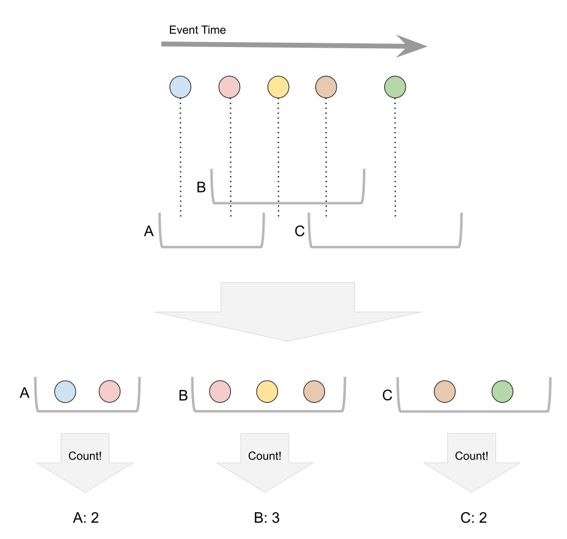
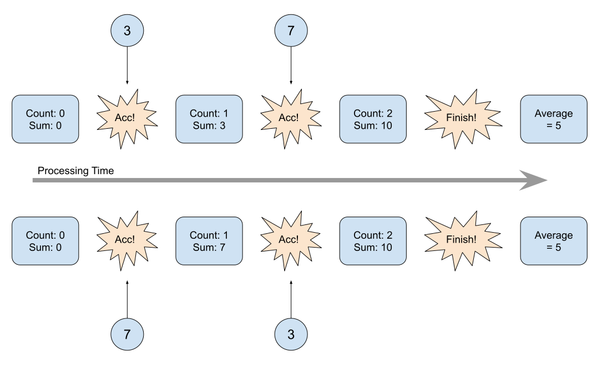
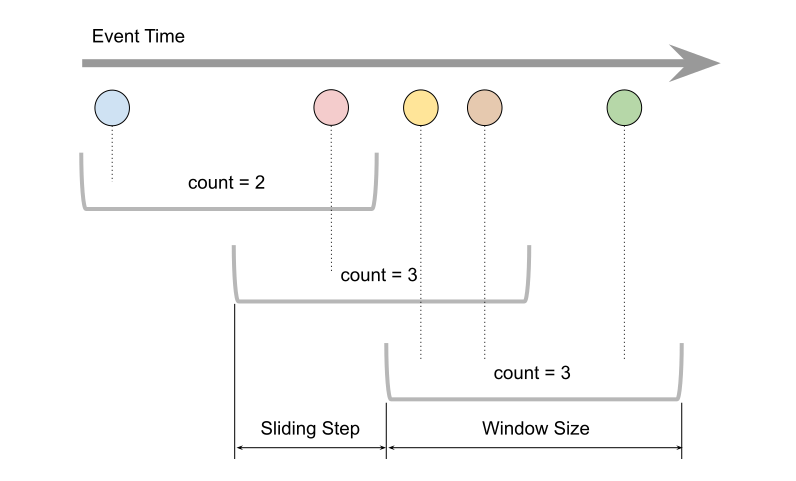
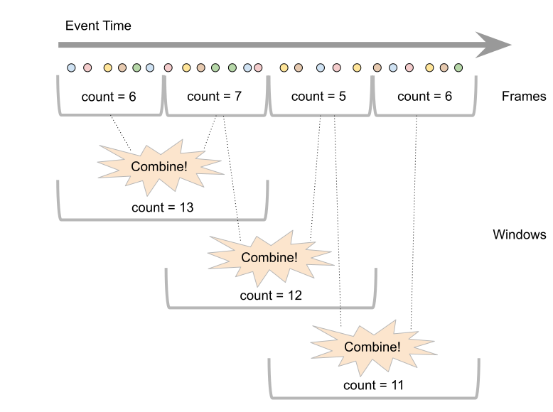
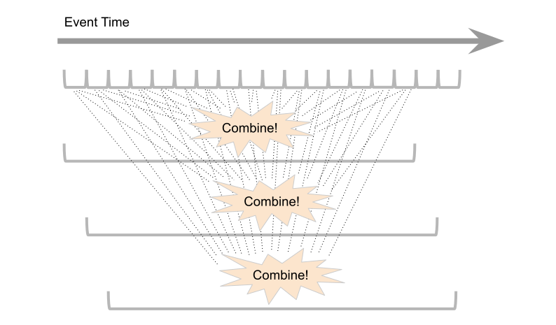
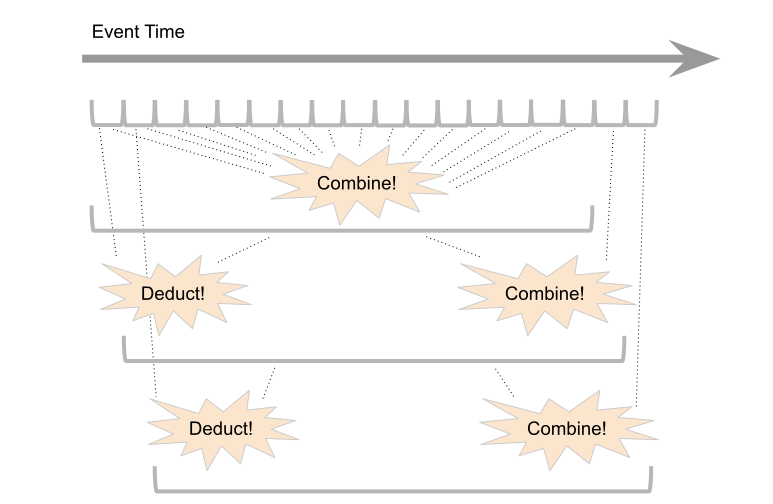
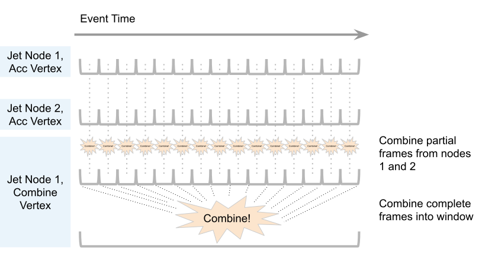

Computing a dynamic quantity like "gretchen83's current speed and direction" requires us to aggregate data over some time period. This is what makes the sliding window so important: it tracks the value of such a quantity in real time.

Hazelcast pays special attention to reducing the computational cost of the sliding window. Let's present the challenges.

## Windowing in General

If we start from the general concept of windowing, this is the basic picture: there is a stream of timestamped data items (*events*) and a set of time intervals called *windows*. They can overlap, so any given event may belong to more than one window. We want to apply an aggregate function to the data of each window. Let's use counting as a simple example:

To compute the output for a window, you must run every item in it through the aggregation algorithm, and you must do this computation for each window independently. Since you may receive the events out of the order of their occurrence, you must retain all the events until the window has "closed" (event time has advanced beyond the window end) and then pass them to the aggregation function in the correct time order.

## Decompose into Accumulation and Finishing

This is where Hazelcast takes the first optimization step: it decomposes the aggregate function into an order-insensitive (commutative) part that runs on every event and has state — the *accumulate* function — and a function that transforms the accumulated state after seeing all the events — the *finish* function:

It turns out that many useful aggregate functions can be decomposed like this and maintain only fixed-size state during the accumulation. Examples are average, standard deviation, slope (linear regression coefficient), min, max etc.

On the other hand, this doesn't constrain us in any way: we can still implement order-sensitive aggregation by keeping the events in a list and sorting it by timestamp in the end.

## The Sliding Window

Now let's focus on the sliding window. This is how our set of windows looks like:

All windows have the same size and they are arranged along the time axis at a constant pitch, called the *sliding step*. Typically, to get smooth sliding, we choose the sliding step to be 1% of the window size. Each event thus ends up in a hundred windows. That's a lot of computation.

## Break into Frames

To avoid this repeated work, Hazelcast breaks down the windows into *frames* whose size is exactly the sliding step and combines the frames into full windows:

Now we need another primitive: the *combine* function. It takes two state objects and combines them into a single object. The ability to combine two states means that our accumulating function must be associative: however we group the events into frames, after combining the result must be the same.

It turns out that we're lucky again: almost all accumulating functions that are commutative are also associative so we still keep the benefit of fixed-size state in each frame.

Let's look at a more realistic picture, showing many small frames being combined into much larger windows:

Even though the cost of combining frames is fixed regardless of how much data is coming in, we still have to perform 100 combining operations for each window (assuming a 1% sliding step). Hazelcast adds yet another function that allows us to reduce this to just two operations for each window: *deduct*:

The *deduct* function reverses the effect of a *combine* and brings the state back to where it would without a particular frame. As the window slides on, we can simply deduct the trailing frame and combine the leading one.

*Deduct* is supported by fewer aggregate functions than *accumulate* and *combine*. For example, you can't use it for *min* or *max* aggregation. It is an optional component in the aggregation process.

## Local Accumulation, Global Combining

So far we haven't considered the distributed nature of computation in Hazelcast. If you have a distributed data source like Kafka, every Hazelcast member consumes a slice of the complete stream. Hazelcast performs the accumulation step locally where the data came in and then sends the frames to a single member where they are combined along two dimensions:

To summarize, this would be the "naïve windowing" picture:

1. Send all the data to a single member
2. Put every event into all the windows it belongs to
3. Keep all the events stored until the window is complete
4. Apply the aggregate function for each window separately

And this is what Hazelcast does for the sliding window:

1. Process events locally, on the member where you received them
2. Don't store the events, apply aggregation right away
3. Aggregate just once, in the single frame where the event belongs
4. Send the aggregated partial results to a single member, for final combining.
