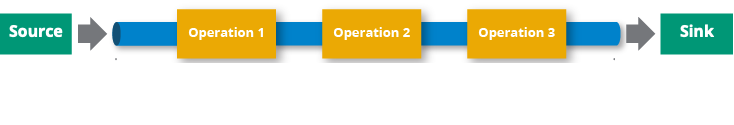

Learn about the core concepts of data pipelines and how you can build your own with the Hazelcast Jet engine.

## What is a Data Pipeline?

A data pipeline (also called a pipeline) is a series of steps for processing data, consisting of three elements:

- One or more [sources](../../connectors/connectors.mdx): Where you take your data comes from.
- Processing stages: What you do to your data.
- At least one [sink](../../connectors/connectors.mdx): Where you send the results of the last processing stage.

Pipelines allow you to process data that's stored in one location and send the result to another such as from a data lake to an analytics database, or into a payment processing system. You can also use the same source and sink such that the pipeline only processes data.

Depending on the data source, pipelines can be used for the following use cases:

- Stream processing: Processes an endless stream of data such as events to deliver results as the data is generated.
- Batch processing: Processes a finite amount of static data for repetitive tasks such as daily reports.

## What is the Jet Engine?

The Jet engine is a batch and stream processing system that allows Hazelcast members to do both stateless and stateful computations over large amounts of data with consistent low latency.

Some features of the Jet engine include:

- Build a multistage cascade of groupBy operations.
- Process infinite out-of-order data streams using event time-based windows.
- Fork data stream to reuse the same intermediate result in more than one way.
- Distribute the processing across all available CPU cores.
- Specify job placement across a defined subset of the cluster

  :::note

  Your license key must include `Advanced Compute` to activate this feature.

  :::

## Pipeline Workflow

The general workflow of a data pipeline includes the following steps:

1. Read data from sources.
2. Send data to at least one sink.

   A pipeline without any sinks is not valid.

To process or enrich data in between reading it from a source and sending it to a sink, you can use transforms.

In Hazelcast, pipelines can be defined using either [SQL](../../get-started/get-started-with-sql/learn-sql.mdx) or the <Variable href="https://docs.hazelcast.org/docs/{os-version}/javadoc/com/hazelcast/jet/pipeline/Pipeline.html" text="Jet API" />.

## Extracting and Ingesting Data

Hazelcast provides a variety of connectors for working with data in a variety of formats and systems, including Hazelcast data structures, Java Messaging Service (JMS), JDBC systems, Apache Kafka, Hadoop Distributed File System, and TCP Sockets.

If a connector doesn't already exist for a source or sink, Hazelcast provides a convenience API so you can easily build a custom one.

For details, see [Connector Guides](../../connectors/connectors.mdx).

## Jobs

Using the high-performance Jet engine, pipelines can process hundreds of thousands of records per second with millisecond latencies using a single member.

To have the Jet engine run a pipeline, it must be submitted to a member. At that point, the pipeline becomes a *job*.

When a member receives a job, it creates a computational model in the form of a Directed Acyclic Graph (DAG). Using this model, the computation is split into tasks that are distributed among all members in the cluster, making use of all available CPU cores. This model allows Hazelcast to process data faster because the tasks can be replicated and executed in parallel across the cluster.

See [Submitting Jobs](./submitting-jobs.mdx).

## Fault-Tolerance and Scalability

To protect jobs from member failures, the Jet engine uses snapshots, which are regularly taken and saved in multiple replicas for resilience. In the event of a failure, a job is restarted from the most recent snapshot, delaying the job for only a few seconds rather than starting it again from the beginning.

To allow you to increase your processing power at will, Hazelcast clusters are elastic, allowing dynamic scaling to handle load spikes. You can add new members to the cluster with zero downtime to linearly increase the processing throughput.

## Next Steps

To get started with the Jet API, see [Get Started with Stream Processing (Embedded)](./get-started/stream-processing-embedded.mdx).

To get started with SQL pipelines, see [Get started with SQL over Kafka](../../get-started/get-started-with-sql/learn-sql.mdx).

For more information about fault tolerance, see [Fault Tolerance](../../operate-and-manage/fault-tolerance/fault-tolerance.mdx).

For details about saving your own snapshots, see [Updating Jobs](./job-update.mdx).

For more general information about data pipelines and their architectures, see our [glossary](https://hazelcast.com/glossary/data-pipeline?utm_source=docs-website).
