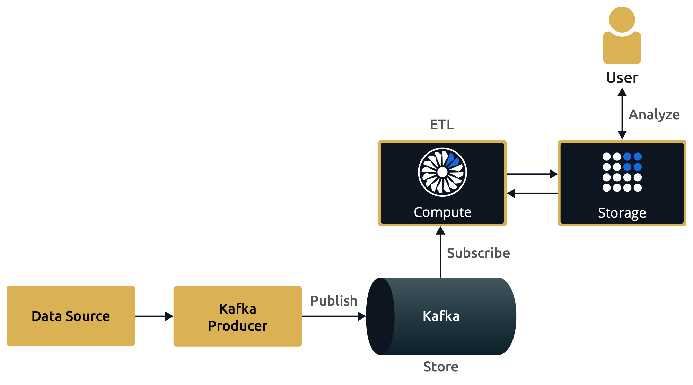

ETL is a pipeline pattern for collecting data from various sources, transforming (changing) it to conform to some rules, and loading it into a sink. This pattern is often used to form materialized views where data is processed and put into a Hazelcast map for fast in-memory queries.

## Extract

The first step is to ingest data into Hazelcast from one or more sources. The data can come from many sources, including files, databases, and streaming sources.

See [Ingesting Data from Sources](../../ingesting-data-from-sources/ingesting-from-sources.mdx) for details of Hazelcast sources.

## Transform

When data is ingested into Hazelcast, it can be transformed for your use case. For example, you may want to aggregate the data for analysis or change it to fit the schema of the destination.

Here are some example methods for transforming data:

- Filtering
- De-duplicating
- Validating
- Aggregating

Performing these transformations in Hazelcast instead of the source limits the performance impact on the source systems and reduces the likelihood of data corruption.

See [Transforms](../../processing-data/transforms.mdx) for more information.

## Load

The last step in any ETL pipeline is to send the data to its final destination, which is often called a sink.

See [Sending Results to Sinks](../../sending-results-to-sinks/sending-data-to-sinks.mdx) for details of Hazelcast sinks.

