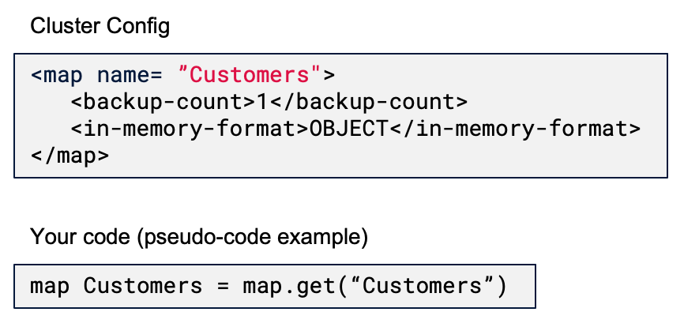
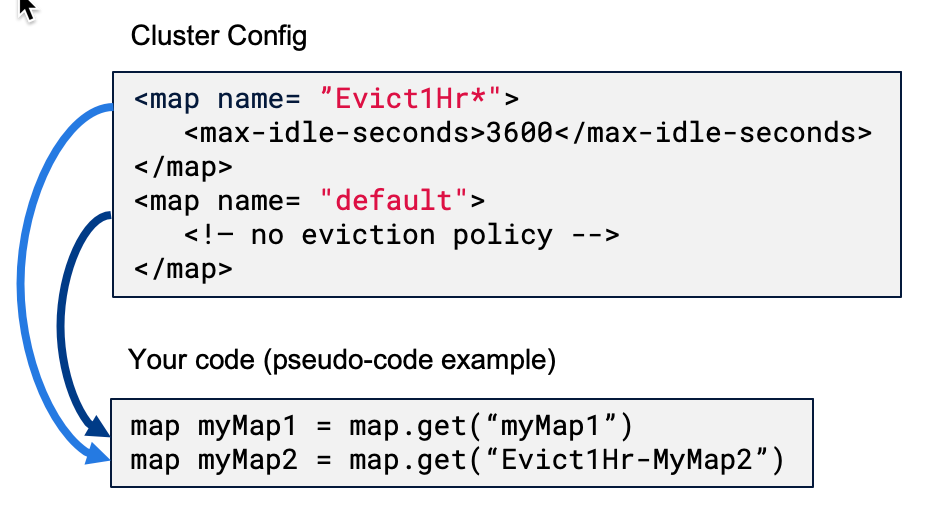

import Tabs from "@theme/Tabs";
import TabItem from "@theme/TabItem";

Map configuration is part of the overall Hazelcast server configuration. When you create your map, it inherits the configuration that is set up on the server. It is important to plan your map configuration ahead of time, as you cannot change the configuration of a map once it is created without restarting your entire cluster.

## Hazelcast Map Configuration Defaults {/* #map-configuration-defaults */}

The `hazelcast.xml`/`hazelcast.yaml` configuration included with your Hazelcast distribution includes the following default settings for maps.

- One synchronous backup
- Binary in-memory format
- All other features are disabled

:::note

To view all possible map settings, refer to the following files included with your Hazelcast distribution.

<IfSnapshot>

- [hazelcast-full-example.xml](https://github.com/hazelcast/hazelcast/blob/master/hazelcast/src/main/resources/hazelcast-full-example.xml)
- [hazelcast-full-example.yaml](https://github.com/hazelcast/hazelcast/blob/master/hazelcast/src/main/resources/hazelcast-full-example.yaml)

</IfSnapshot>

<IfNotSnapshot>

- <Variable href="https://github.com/hazelcast/hazelcast/blob/v{os-version}/hazelcast/src/main/resources/hazelcast-full-example.xml" text="hazelcast-full-example.xml" />
- <Variable href="https://github.com/hazelcast/hazelcast/blob/v{os-version}/hazelcast/src/main/resources/hazelcast-full-example.yaml" text="hazelcast-full-example.yaml" />

</IfNotSnapshot>

:::

If these settings are sufficient for your environment, you don't need to do anything else. When you create a map, the Hazelcast cluster will apply these settings to your map.

For details on map backups, refer to [Making Your Map Data Safe](./backing-up-maps.mdx).

For details on in-memory format, refer to [Setting the In-Memory Format of Map Entries](./setting-data-format.mdx).

## The Default (Fallback) Map Configuration

When a map is created, if the map name matches an entry in the `hazelcast.xml`/`hazelcast.yaml` file, the values in the matching entry are used to overwrite the initial values discussed in the [Map Configuration Defaults](#map-configuration-defaults) section.

Maps that do not have any configuration defined use the default configuration. If you want to set a configuration that is valid for all maps, you can name your configuration as `default`. A user-defined default configuration applies to every map that does not have a specific custom map configuration defined with the map's name. You can also use wildcards to associate your configuration with multiple map names. See the [configuration documentation](../../../../operate-and-manage/configuration/static-configuration/using-wildcards.mdx) for more information about wildcards.

When a map name does not match any entry in the `hazelcast.xml`/`hazelcast.yaml` file then:

- If the `default` map configuration exists, the values under this entry are used to overwrite initial values. Therefore, `default` serves as a fallback.
- If a `default` map configuration does not exist, the map is created with initial values as discussed in [Map Configuration Defaults](#map-configuration-defaults).

## Modifying the Default (Fallback) Configuration

In the following example, we set expiration timers for dynamically created maps that lack a named configuration block. Map entries that are idle for an hour will be marked as eligible for removal if the cluster begins to run out of memory. Any map entry older than six hours will be marked as eligible for removal.

For more on entry expiration, go to [Managing Map Memory](./managing-map-memory.mdx).

<Tabs groupId="config-format">
<TabItem value="xml" label="XML">

```xml conums
<hazelcast>
    ...
    <map name="default">
        <backup-count>1</backup-count> <1>
        <in-memory-format>BINARY</in-memory-format> <2>
        <max-idle-seconds>3600</max-idle-seconds>
        <time-to-live-seconds>21600</time-to-live-seconds>
    </map>
    ...
</hazelcast>
```

<CodeCallouts>

1. We did not want to modify the default backup count. If this line were omitted, we would have no backups.
2. You must specify an in-memory format.

</CodeCallouts>

</TabItem>
<TabItem value="yaml" label="YAML">

```yaml conums
hazelcast:
    map:
        default:
            backup-count: 1 <1>
            in-memory-format: BINARY <2>
            max-idle-seconds: 3600
            time-to-live-seconds: 21600
```

<CodeCallouts>

1. We did not want to modify the default backup count. If this line were omitted, we would have no backups.
2. You must specify an in-memory format.

</CodeCallouts>

</TabItem>
</Tabs>

## Multiple Map Configurations

Your application may require multiple maps with different settings. To accomplish this, you can create multiple named map configurations. The Hazelcast cluster will apply the stored configuration to each map when the map is created, based on the name of the map. If there's no name match, the map will use the settings in the default configuration.

In this example, we're creating a configuration for the Customers map and setting the in-memory format to OBJECT. When we run our code, Hazelcast will match the map name to the configuration name and apply all the settings included under Customers.



Note that we specified the number of backups as well as the in-memory format. Hazelcast will only apply settings under the Customers configuration and ignore all others, including the default configuration. We want our data backed up, so we have to include this in the Customers configuration as well as the in-memory format.

## Using Wildcards



Wildcards allow you to create one configuration and apply it to multiple maps. Here we have two map configurations. One sets the eviction timer to mark entries for removal after being untouched for one hour (3600 seconds). The other has no eviction policy. Because we used a wildcard in the configuration name, any map name beginning with Evict1Hr will use the Evict1Hr\* configuration. Any other map will use whatever settings are part of the default configuration.

You can use wildcards to create standard configurations for your application, then apply those configurations to individual maps. As long as the map name passed to the Hazelcast cluster matches the wildcard string, the cluster will apply the specific configuration when it creates the map.

## Next Steps

For a complete discussion of Hazelcast configuration options and operations, go to the [configuration](../../../../operate-and-manage/configuration/understanding-configuration.mdx) section of the documentation.
