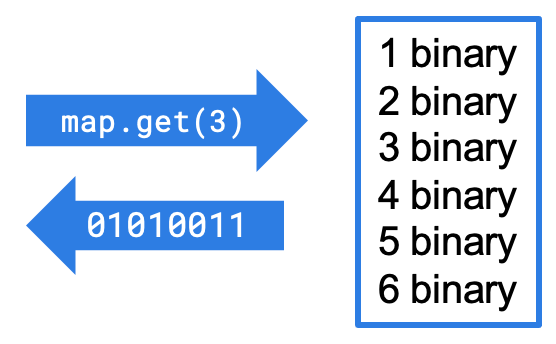
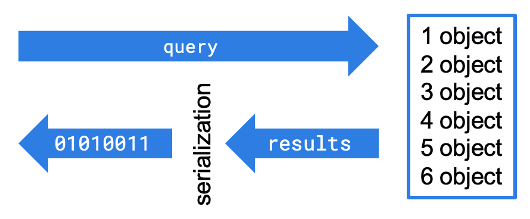

import Tabs from "@theme/Tabs";
import TabItem from "@theme/TabItem";

<Anchor id="setting-in-memory-format" />

The in-memory format you set to store your data can have a significant impact on the performance of your application. When data is moved either between a client and the Hazelcast cluster or between cluster members, it is always in serialized (binary) format. Depending on your use case, it may be more efficient to store the data in that serialized format, either on-heap or off-heap, or deserialize it back to the original object format.

## In-Memory Format Operations

The first thing to keep in mind is that serialization of your data always happens. The goal of setting the in-memory format is to minimize the overhead of serialization by only performing the operation when necessary.

When data arrives at the Hazelcast cluster for loading into a map, it is in binary (serialized) format - a requirement for transmission over a network. By default, Hazelcast stores those map entries as-is, in binary (serialized) format in on-heap memory.

If the majority of your cluster operations are reads (`get`) and writes (`put`), leaving the data in `BINARY` format is most efficient. In a `put` operation, the application performing the put serializes the data for transmission over the network. The cluster member simply writes the received data to the map without any format changes. In a `get` operation, the cluster member returns a binary copy of the requested map entry. The application performs the necessary deserialization on the returned data.



However, if the majority of your cluster operations are queries, deserialization overhead becomes a concern. Queries have to run against objects, not binary data. By storing your frequently-queried data in `OBJECT` format, you incur the deserialization overhead when the data is added to the map. The data is stored in the correct format for queries. Query results are serialized before being returned to the cluster member coordinating the query (see [How Distributed Query Works](../../../improving-query-performance/indexing-maps.mdx) for a complete description of how Hazelcast handles queries.) If you stored frequently-queried maps in binary format, the entire map would need to be deserialized within the cluster before the query could run.



You should also use the `OBJECT` format if you are performing processing within the cluster directly on the map data (e.g. using an [entry processor](./entry-processor.mdx)).

## Configuring In-Memory Format

To configure how the cluster will store map data, set the `in-memory-format` element in the configuration:

- `BINARY` (default): The data (both the key and value) is stored in serialized binary format.
- `OBJECT`: The data is stored in deserialized form. The key is still stored in binary format.
- `NATIVE`: (**Hazelcast <Variable name="enterprise-product-name" />**) The data is stored in serialized binary format, outside the JVM heap.

<Tabs groupId="config-format">
<TabItem value="xml" label="XML">

```xml
<hazelcast>
    ...
    <map name="objectMap">
        <in-memory-format>OBJECT</in-memory-format>
    </map>
    ...
</hazelcast>
```

</TabItem>
<TabItem value="yaml" label="YAML">

```yaml
hazelcast:
  map:
    objectMap:
      in-memory-format: OBJECT
```

</TabItem>
</Tabs>

## Storing Map Entries Off-Heap with High-Density Memory Store (HD Memory) {/* #using-high-density-memory-store-with-map */}

<Badge type="enterprise" />

Hazelcast instances run within Java Virtual Machines (JVMs). JVMs use a process called Garbage Collection (GC) to manage memory utilization. GC is an interrupting process, and the larger the heap, the longer GC takes to complete. This interruption could cause your application to pause for tens of seconds (even minutes for really large heaps), badly affecting your application performance and response times. To avoid the GC delay, most JVMs are implemented with a maximum size of 4 to 8 GB.

The Hazelcast [High-Density (HD) Memory Store](../../../../operate-and-manage/high-density-memory/overview.mdx) overcomes the limitation of garbage collection, allowing you to deploy fewer cluster members with much larger memory configurations. Instead of relying on the Java garbage collection, Hazelcast stores the data off-heap and performs the necessary memory management and cleanup. Data stored using HDMS is kept in binary format.

You can configure a map to use HD memory store by setting the in-memory format to `NATIVE`. The following snippet is the declarative configuration example.

<Tabs groupId="config-format">
<TabItem value="xml" label="XML">

```xml
<hazelcast>
    ...
    <map name="nativeMap">
        <in-memory-format>NATIVE</in-memory-format>
    </map>
    ...
</hazelcast>
```

</TabItem>
<TabItem value="yaml" label="YAML">

```yaml
hazelcast:
  map:
    nativeMap:
      in-memory-format: NATIVE
```

</TabItem>
</Tabs>

Keep in mind that you should have already enabled HD memory usage for your cluster. See the [Configuring High-Density Memory Store section](../../../../operate-and-manage/high-density-memory/overview.mdx#configuring-high-density-memory-store).

Note that `NATIVE` memory stores data in binary format. Maps stored in the HD memory store have to be deserialized before they can be queried. A best practice is to use on-heap memory for maps that will be frequently queried when possible.

:::note

From JDK 24, Java gives a warning when using HD Memory due to [JEP 498](https://openjdk.org/jeps/498). To avoid this warning, add `--sun-misc-unsafe-memory-access=allow` to your [Java command](../../../../operate-and-manage/configuration/static-configuration/jvm-parameters.mdx) when launching Hazelcast.

:::
