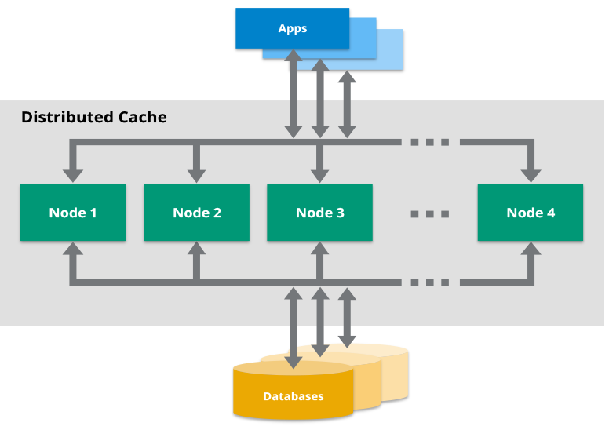
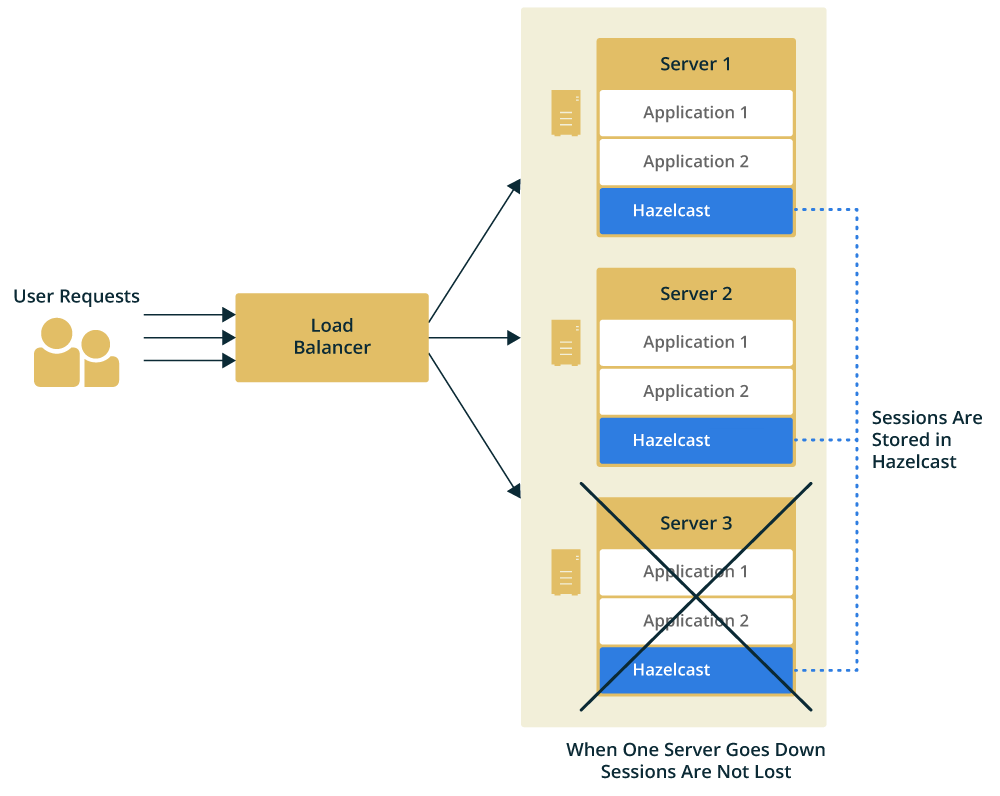

Hazelcast provides APIs and plugins for building distributed caches for your data, including web sessions, database queries, and compute results. Get familiar with Hazelcast as a cache and find useful resources for your use case.

## What is a Cache?

A cache is a secondary data store that's faster to read than the data's primary store (also known as the source of truth).

The purpose of a cache is to improve the performance of your applications by doing the following:

- Reducing network calls to a primary data store.
- Saving the results of queries or computations to avoid resubmitting them.

Data stored in a cache is often kept in random-access memory (RAM) because its faster to read.

In Hazelcast, the RAM of all cluster members is combined into a single in-memory data store to provide fast access to data. This distributed model is called a *cache cluster*, and it makes your data fault-tolerant and scalable. If a member goes down, your data is repartitioned across the remaining members. And, if you need more or fewer resources, you can add or remove members as necessary.

## Caching Topologies

To use Hazelcast as a distributed cache, you can choose one of the following topologies:

- Embedded mode: In this mode, the application and the cached data are stored on the same device. When a new entry is written to the cache, Hazelcast takes care of distributing it to the other members.
- Client/server mode: In this mode, the cached data is separated from the application. Hazelcast members run on dedicated servers and applications connect to them through clients.

<table>
<colgroup>
<col style={{width:'33.3333%'}} />
<col style={{width:'33.3333%'}} />
<col style={{width:'33.3334%'}} />
</colgroup>
<thead>
<tr>
<th>Topology</th>
<th>Advantages</th>
<th>Disadvantages</th>
</tr>
</thead>
<tbody>
<tr>
<td>Embedded</td>
<td>Data access is faster because applications don't need to send a request to the cache cluster over the network.</td>
<td>

Hazelcast can be embedded only in Java applications.

Each new instance of your application adds a new member to the cluster even if you don't it.

</td>
</tr>
<tr>
<td>Client/server</td>
<td>

Supports independent scaling of the application and the cache cluster.

Allows you to write polyglot applications that can all connect to the same cache cluster.

</td>
<td>To read from a cache or write to it, clients need to make network requests, which leads to higher latency than embedded mode.</td>
</tr>
</tbody>
</table>

For more information about topologies, see [Choosing an Application Topology](../../install-and-upgrade/overview/choosing-a-deployment-option.mdx).

## Caching Data on the Client-Side

If you use the client-server topology, your application will request cached data from your cluster over a network.

To reduce these network requests, you can enable a near cache on the client.

A near cache is a local cache that is created on the client. When an application wants to read data, first it looks for the data in the near cache. If the near cache doesn't have the data, the application requests it from the cache cluster and adds it to the near cache to use for future requests.

For information about how to use a near cache, see [Best practices](../best-practices/overview.mdx).

## Caching Patterns

The way in which an application interacts with a cache is called a caching pattern. Many patterns exist and each one has its pros and cons.

For an in-depth discussion on caching patterns in Hazelcast, see our blog [A Hitchhiker's Guide to Caching Patterns](https://hazelcast.com/blog/a-hitchhikers-guide-to-caching-patterns/?utm_source=docs-website).

## Cache in Spring Applications

[Spring](https://spring.io/projects/spring-framework) is a framework that comes with out-of-the-box modules for developing Java applications.

To allow you to easily plug a cache cluster into your Spring application, Hazelcast includes a Spring integration.

For more information about caching in Spring applications, see the following:

- [Integrating with Spring](../../frameworks-and-plugins/spring/overview.mdx)
- [Spring Reference Documentation](https://docs.spring.io/spring-boot/docs/current/reference/htmlsingle/#features.hazelcast)
- [Getting Started with Hazelcast using Spring Boot](https://guides.hazelcast.org/hazelcast-embedded-springboot/)
- [Caching in SpringBoot Microservices](https://guides.hazelcast.org/caching-springboot/)
- [Session Replication with Spring Boot](https://guides.hazelcast.org/caching-springboot/)

## Second-Level Cache for Hibernate

[Hibernate](http://hibernate.org) is a framework for mapping an object-oriented domain model to a relational database in Java applications.

To make it faster to read data, Hibernate uses a multilevel caching scheme:

- First-level cache: A mandatory cache that stores the `Session` object until the session is closed.
- Second-level cache: An optional cache that's mainly responsible for caching objects across sessions.

To use Hazelcast as a second-level cache, see the following:

- [Hazelcast Hibernate documentation](https://github.com/hazelcast/hazelcast-hibernate)
- [Getting Started with Hazelcast and Hibernate Second-Level Cache](https://guides.hazelcast.org/springboot-hibernate/)

## Cache Manager in JCache

JCache is a standard caching API for the Java programming language.

To find out more about JCache and how to use Hazelcast as the caching provider, see [JCache Overview](./ap-data-structures/jcache/overview.mdx).

## Caching Web Sessions in Hazelcast

To support more users, web applications often consist of multiple instances running at the same time. This way, traffic can be routed to different instances through load balancers to maximize speed and reliability.

However, in this architecture, if a server fails and the load balancer redirects the user to a new server, the session data is lost because sessions are stored on specific application servers.

The solution to this problem is to provide web session clustering (also known as web session replication) which allows any application server to access the same system-wide cache of web session data.

Hazelcast provides native integration for the Apache Tomcat and Eclipse Jetty application servers as well as for generic application servers through the use of filters.

To use Hazelcast for web session replication, see the following resources:

- [Filter-Based Web Session Replication](https://github.com/hazelcast/hazelcast-wm)
- [Tomcat-Based Web Session Replication](https://github.com/hazelcast/hazelcast-tomcat-sessionmanager)

  - [Tomcat Session Replication with Spring Boot and Hazelcast](https://guides.hazelcast.org/springboot-tomcat-session-replication)
- [Jetty-Based Web Session Replication](https://www.eclipse.org/jetty/documentation/current/configuring-sessions-hazelcast.html)

## Caching with JDBC Data Stores

To configure a cache with a connection to JDBC data store, see [Using the generic MapStore](../working-with-external-data/configuring-a-generic-mapstore.mdx).

## Building a Custom Database Cache

To build your own database cache, see [Implementing a Custom MapStore](../working-with-external-data/implement-a-mapstore.mdx).

## Related Resources

For all Hazelcast integrations, see [Hazelcast Plugins](../../frameworks-and-plugins/hazelcast-plugins/overview.mdx).
