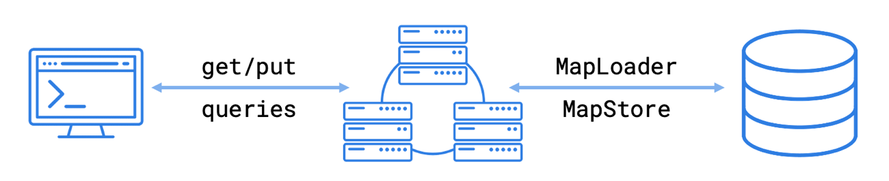

MapStore is an API for building a cache on top of Hazelcast. To build a cache, you can either use a pre-built component, which requires little or no coding. Or, you can use a custom option that allows you to write the interface yourself.

## MapLoader or MapStore

You can use either the `MapLoader` or `Mapstore` interfaces to set up a cache, depending on your use case.

MapLoader allows you to connect to an external system to load data into your cluster. For example, you can use a MapLoader to load data from a MongoDB, MySQL, PostgreSQL database or a Kafka data stream into your cluster. MapLoader supports read-through caching only.

MapStore extends this functionality. It loads data but also writes data back to your external system to keep it synchronized with data on your cluster. MapStore supports all the following caching patterns: read-through, write-through, write-behind.

Both interfaces include methods that are triggered when operations are invoked on a map.

## Supported Caching Patterns

- Read-through (always): If an entry does not exist in memory when an application asks for it, Hazelcast asks the MapLoader/MapStore implementation to load that entry from the external system. If the entry exists, the MapLoader/MapStore implementation requests it from the external system and Hazelcast puts it into memory.
- Write-through (default): When new entries are added to a map, those entries are added to the external system synchronously.
- Write-behind (requires [configuration](./configuration-guide.mdx#write-behind)): When new entries are added to a map, those entries are added to the external system asynchronously, after a configured delay.

## Options for Building a MapStore {/* #options */}

To build a cache, you can use a pre-built, generic MapLoader or MapStore that comes with Hazelcast. This option requires you to write little to no Java code. Or, you can write a custom implementation using the `MapLoader` or `MapStore` interfaces.

### Generic MapLoader or MapStore {/* #low-code */}

The [generic MapLoader](./configuring-a-generic-maploader.mdx) and [generic MapStore](./configuring-a-generic-mapstore.mdx) use a [data connection](../data-connections/data-connections-configuration.mdx) to access your data held in an external system. The data connection contains the metadata that Hazelcast needs to establish a connection. For example, a database name, username, and password.

If Hazelcast provides a [type of data connection](../data-connections/data-connections-configuration.mdx#connectors) for your external system, you can configure your cluster to use it, without writing any Java code.

### Custom MapStore {/* #custom */}

If you need full control over how your cache works, [implement your own in Java](./implement-a-mapstore.mdx). The connection to your external system is handled in your MapStore implementation.

## Next Steps

[Using the generic MapLoader](./configuring-a-generic-maploader.mdx)

[Using the generic MapStore](./configuring-a-generic-mapstore.mdx)

[Implementing a Custom MapStore](./implement-a-mapstore.mdx)
