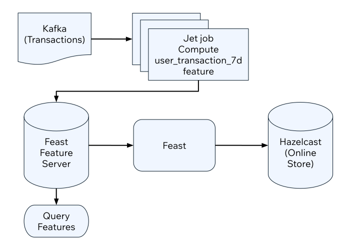

This tutorial will get you started with streaming features using the Hazelcast integration with Feast.

## What You'll Learn

You will setup an offline feature store with PostgreSQL and an online feature store with Hazelcast. Then update the online feature store using a Jet job in real time from transactions streaming in a Kafka topic.

Overview of Feast streaming workflow



## Before you Begin

You will need the following ready before starting the tutorial:

- Hazelcast CLC (see <Variable href="/clc/{page-latest-supported-clc}/install-clc" text="Install CLC" />)
- A recent version of Docker and Docker Compose

To set up your project, complete the following steps:

1. Create the sample project using the following command:

   ```shell
   clc project create -t feast-streaming-demo
   ```
2. Switch to the project directory:

   ```shell
   cd feast-streaming-demo
   ```
3. In the project directory, start the containers:

   ```shell
   docker-compose up
   ```
4. Login to the demo container:

   ```shell
   docker-compose exec demo /bin/bash
   ```

To set up Feast, complete the following steps:

1. The Feast project is in the `feature_repo` directory. You can take a look at the Feast configuration using the following command:

   ```shell
   cat feature_repo/feature_store.yaml
   ```

   ```yaml
   project: feast_streaming

   registry: /home/sam/feast/data/registry.db

   provider: local

   online_store:
       type: hazelcast
       cluster_name: dev
       cluster_members: ["hazelcast:5701"]

   offline_store:
     type: file

   entity_key_serialization_version: 2
   ```
2. The feature views are defined in the `features.py`. Run the following command to see its contents:

   ```shell
   cat feature_repo/features.py
   ```

   ```python
   from datetime import timedelta
   from feast import FeatureView, Entity, ValueType, Field
   from feast.data_source import PushSource
   from feast.infra.offline_stores.contrib.postgres_offline_store.postgres_source import PostgreSQLSource
   from feast.types import Int32

   user_entity = Entity(
       name="user_id",
       description="A user that has executed a transaction or received a transaction",
       value_type=ValueType.STRING
   )

   user_transaction_count_7d_source = PushSource(
       name="user_transaction_count_7d",
       batch_source=PostgreSQLSource(
           table="user_transaction_count_7d",
           timestamp_field="feature_timestamp"),
   )

   user_transaction_count_7d_stream_fv = FeatureView(
       schema=[
           Field(name="transaction_count_7d", dtype=Int32),
       ],
       name="user_transaction_count_7d",
       entities=[user_entity],
       ttl=timedelta(weeks=1),
       online=True,
       source=user_transaction_count_7d_source,
   )
   ```
3. Before you can use features, you must run the following command:

   ```shell
   feast -c feature_repo apply
   ```

   Outputs:

   ```output
   Deploying infrastructure for user_transaction_count_7d
   ```
4. At this point, you are ready to start the feature server. Note that the command below prevents the `feast` process from outputting to the terminal, since you will use the same terminal for running other commands.

   ```shell
   feast -c feature_repo serve -h 0.0.0.0 -p 6566 --no-access-log 2> /dev/null &
   ```

## Feature Transformation Using Jet

You will create a Jet job that reads transactions from a Kafka topic, computes the number of transactions per user in the last seven-days' buckets and populates the Hazelcast online store.

1. Before creating the Jet job, you may want to see how the jobs are created by running the following command:

   ```shell
   cat jet/streaming_features/src/main/java/com/example/Main.java
   ```

   ```java
   package com.example;

   import com.fasterxml.jackson.databind.ObjectMapper;
   import com.hazelcast.core.Hazelcast;
   import com.hazelcast.core.HazelcastInstance;
   import com.hazelcast.jet.aggregate.AggregateOperations;
   import com.hazelcast.jet.kafka.KafkaSources;
   import com.hazelcast.jet.pipeline.Pipeline;
   import com.hazelcast.jet.pipeline.StreamSource;
   import com.hazelcast.jet.pipeline.WindowDefinition;
   import com.hazelcast.map.impl.MapEntrySimple;
   import org.apache.kafka.common.serialization.StringDeserializer;

   import java.util.Date;
   import java.util.Map;
   import java.util.Properties;

   import static com.hazelcast.jet.aggregate.AggregateOperations.counting;
   import static com.hazelcast.jet.pipeline.WindowDefinition.sliding;
   import static java.util.concurrent.TimeUnit.DAYS;
   import static java.util.concurrent.TimeUnit.SECONDS;

   public class Main {
       private final static long MONITORING_INTERVAL_7_DAYS = DAYS.toMillis(7);
       private final static long REPORTING_INTERVAL = SECONDS.toMillis(1);

       public static Pipeline createPipeline(String feastBaseUrl, String kafkaBaseUrl) {
           var mapper = new ObjectMapper();
           Properties props = new Properties();
           props.setProperty("bootstrap.servers", kafkaBaseUrl);
           props.setProperty("key.deserializer", StringDeserializer.class.getCanonicalName());
           props.setProperty("value.deserializer", StringDeserializer.class.getCanonicalName());
           props.setProperty("auto.offset.reset", "earliest");

           StreamSource<Map.Entry<String, String>> kafkaSource = KafkaSources.kafka(props, "transaction");
           Pipeline pipeline = Pipeline.create();
           pipeline
                   .readFrom(kafkaSource)
                   .withNativeTimestamps(0)
                   .map(item -> mapper.readValue(item.getValue(), Transaction.class))
                   .groupingKey(Transaction::getAcct_num)
                   .window(sliding(MONITORING_INTERVAL_7_DAYS, REPORTING_INTERVAL))
                   .aggregate(counting())
                   .map(item -> {
                       var userId = item.getKey();
                       // set the current datetime
                       var timestamp = new Date();
                       var utc = new UserTransactionCount7d(userId, item.getValue(), timestamp);
                       return (Map.Entry<String, UserTransactionCount7d>) new MapEntrySimple(userId, utc);
                   })
                   .map(item -> mapper.writeValueAsString(item.getValue()))
                   .writeTo(FeastSinks.push(feastBaseUrl, "user_transaction_count_7d"));
           return pipeline;
       }

       public static void main(String[] args) {
           var feastBaseUrl = "http://localhost:6566";
           var kafkaBaseUrl = "localhost:9092";
           if (args.length >= 1) {
               feastBaseUrl = args[0];
           }
           if (args.length >= 2) {
               kafkaBaseUrl = args[1];
           }
           Pipeline pipeline = createPipeline(feastBaseUrl, kafkaBaseUrl);
           HazelcastInstance hz = Hazelcast.bootstrappedInstance();
           hz.getJet().newJob(pipeline);
       }
   }
   ```
2. You must compile the Java code that creates the Jet job. We provided an easy-to-use script to do that from inside the demo container:

   ```shell
   run build_jet streaming_features
   ```
3. You can now create the Jet job and run it. The Jet job requires the addresses of the feature server and the Kafka instance:

   ```shell
   clc job submit --name transform_features build/jet/streaming_features/libs/*.jar http://demo:6566 kafka:19092
   ```
4. You can list the running jobs and verify that the jobs completed successfully using the following command:

   ```shell
   clc job list
   ```

   Outputs:

   ```output
   ------------------------------------------------------------------------------------------------
    Job ID              | Name               | Status  | Submitted           | Completed
   ------------------------------------------------------------------------------------------------
    0c13-9428-92c4-0001 | transform_features | RUNNING | 2024-07-29 07:18:53 | -
   ```
5. Running the Jet job created an IMap that corresponds to the "user\_transaction\_count\_7d" feature in the Hazelcast cluster. You can list it using the following command:

   ```shell
   clc object list map
   ```

   Outputs:

   ```output
   -------------------------------------------
    Object Name
   -------------------------------------------
    feast_streaming_user_transaction_count_7d
   -------------------------------------------
       OK Returned 1 row(s).
   ```
6. Check the contents of the feature IMap to check the data written by Feast:

   ```shell
   clc map -n feast_streaming_user_transaction_count_7d entry-set | head -10
   ```
7. You can retrieve features from the feature server in a human-readable format:

   ```shell
   curl -X POST \
     "http://localhost:6566/get-online-features" \
     -d '{
       "features": [
         "user_transaction_count_7d:transaction_count_7d"
       ],
       "entities": {
         "user_id": ["EBJD80665876768751", "YVCV56500100273531", "QRQP56813768247223"]
       }
     }' | jq
   ```

   Outputs something similar to:

```
{
  "metadata": {
    "feature_names": [
      "user_id",
      "transaction_count_7d"
    ]
  },
  "results": [
    {
      "values": [
        "EBJD80665876768751",
        "YVCV56500100273531",
        "QRQP56813768247223"
      ],
      "statuses": [
        "PRESENT",
        "PRESENT",
        "PRESENT"
      ],
      "event_timestamps": [
        "1970-01-01T00:00:00Z",
        "1970-01-01T00:00:00Z",
        "1970-01-01T00:00:00Z"
      ]
    },
    {
      "values": [
        6,
        11,
        11
      ],
      "statuses": [
        "PRESENT",
        "PRESENT",
        "PRESENT"
      ],
      "event_timestamps": [
        "2024-07-29T07:24:00Z",
        "2024-07-29T07:24:00Z",
        "2024-07-29T07:24:00Z"
      ]
    }
  ]
}
```

## Summary

In this tutorial, you learned how to set up a feature engineering project that uses Hazelcast as the online store. You also learned how to write a Jet job that transforms data and sends it to a Feast feature server.

## See Also

There is more to feature engineering with Hazelcast.

Check out our documentation about Feast:

- [Integrate with Feast](./overview.mdx)
- [Configure Feature Store](./feast-config.mdx)

If you have any questions, suggestions, or feedback please do not hesitate to reach out to us through [Hazelcast Community Slack](https://slack.hazelcast.com/).
