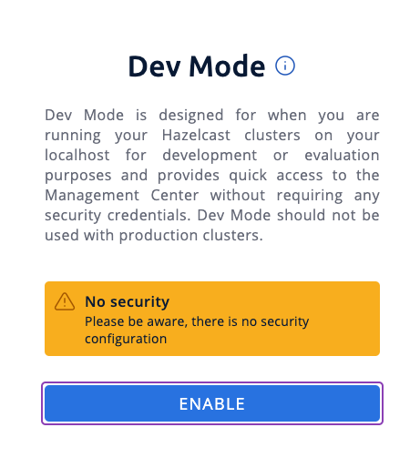
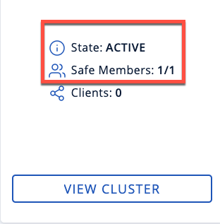

import Tabs from "@theme/Tabs";
import TabItem from "@theme/TabItem";

Follow this five-minute tutorial to set up a Hazelcast cluster for testing or evaluation purposes. In five minutes, you will learn how to install Hazelcast with a package manager, start a local cluster with the CLI, write data to memory and visualize that data.

## Step 1. Install Hazelcast

1. To install Hazelcast, use the appropriate command for your operating system:

   <Tabs groupId="os">
   <TabItem value="mac" label="Mac">

   To install on macOS, use the Homebrew package manager.

   ```bash vars
   brew tap hazelcast/hz
   brew trust hazelcast/hz
   brew install hazelcast@{os-version}
   ```

   </TabItem>
   <TabItem value="linux" label="Linux">

   You can use either of these package managers to install Hazelcast, depending on your Linux distribution:

   ```shell title="Debian" vars
   sudo apt-get install -y --no-upgrade wget gpg coreutils \
     && wget -qO - https://repository.hazelcast.com/api/gpg/key/public | gpg --dearmor | sudo tee /usr/share/keyrings/hazelcast-archive-keyring.gpg > /dev/null \
     && echo "deb [signed-by=/usr/share/keyrings/hazelcast-archive-keyring.gpg] https://repository.hazelcast.com/debian stable main" | sudo tee -a /etc/apt/sources.list \
     && sudo apt update && sudo apt install hazelcast={os-version}
   ```

   ```shell title="RPM" vars
   sudo yum -y install wget \
     && wget https://repository.hazelcast.com/rpm/stable/hazelcast-rpm-stable.repo -O hazelcast-rpm-stable.repo \
     && sudo mv hazelcast-rpm-stable.repo /etc/yum.repos.d/ \
     && sudo yum install hazelcast-{os-version}
   ```

   </TabItem>
   <TabItem value="windows" label="Windows">

   Hazelcast does not support any Windows package managers.

   To get started with Hazelcast on Windows, you can use [Docker](./get-started-docker.mdx), the [binary distribution](./get-started-binary.mdx), or [Java](./get-started-java.mdx).

   </TabItem>
   </Tabs>
2. Check that Hazelcast Platform is correctly installed:

   ```shell
   hz -V
   ```

   You should see the version of both Hazelcast and the command line tool.

## Step 2. Start a Local Cluster

Hazelcast clusters consist of servers that we call members. These members communicate with each other to form a distributed network. It's these members that store and process your data.

1. To start a standalone Hazelcast member, use the following command:

   ```shell
   hz start
   ```

   You should see the following in the console:

   ```shell conums vars
   INFO: [192.168.1.164]:5701 [dev] [{full-version}] <1>

   Members {size:1, ver:1} [ <2>
   	Member [192.168.1.164]:5701 - 4221d540-e34e-4ff2-8ad3-41e060b895ce this
   ]
   ```

   <CodeCallouts>

   1. The local IP address of your Hazelcast member followed by the default cluster name (dev) and the version of Hazelcast that you are running.
   2. The size of your cluster. Here, you just have one member, so the size is 1.

   </CodeCallouts>
2. To add one more member to the cluster, open another terminal window and run the `start` command again.

   ```shell
   hz start
   ```

   The members discover each other automatically and form a two-member cluster. You should see the following in the console:

   ```shell
   Members {size:2, ver:2} [
       Member [127.0.0.1]:5701 - e40081de-056a-4ae5-8ffe-632caf8a6cf1 this
       Member [127.0.0.1]:5702 - 93e82109-16bf-4b16-9c87-f4a6d0873080
   ]
   ```

:::note

These members use the default configuration, which is defined in the `hazelcast.xml` file. The location of this file is printed on the first line of the output of the `start` command.

:::

## Step 3. Connect the Management Center

Management Center is a user interface for managing and monitoring your cluster.

In this step, you install and start a local instance of Management Center and connect it to your cluster.

1. To install Management Center, use one of the following methods, depending on your operating system:

   <Tabs groupId="os">
   <TabItem value="mac" label="Mac">

   To install on macOS, use the Homebrew package manager.

   ```bash vars
   brew tap hazelcast/hz
   brew trust hazelcast/hz
   brew install hazelcast/hz/hazelcast-management-center@{full-version}
   ```

   </TabItem>
   <TabItem value="linux" label="Linux">

   To install on Linux, you can use either of these package managers, depending on your Linux distribution:

   <IfSnapshot>

   ```shell title="Debian"
   wget -qO - https://repository.hazelcast.com/api/gpg/key/public | gpg --dearmor | sudo tee /usr/share/keyrings/hazelcast-archive-keyring.gpg > /dev/null
   echo "deb [signed-by=/usr/share/keyrings/hazelcast-archive-keyring.gpg] https://repository.hazelcast.com/debian snapshot main"| sudo tee -a /etc/apt/sources.list
   sudo apt update && sudo apt install hazelcast-management-center
   ```

   ```shell title="RPM"
   wget https://repository.hazelcast.com/rpm/snapshot/hazelcast-rpm.repo -O hazelcast-snapshot-rpm.repo
   sudo mv hazelcast-snapshot-rpm.repo /etc/yum.repos.d/
   sudo yum install hazelcast-management-center
   ```

   </IfSnapshot>

   <IfNotSnapshot>

   ```shell title="Debian" vars
   wget -qO - https://repository.hazelcast.com/api/gpg/key/public | gpg --dearmor | sudo tee /usr/share/keyrings/hazelcast-archive-keyring.gpg > /dev/null
   echo "deb [signed-by=/usr/share/keyrings/hazelcast-archive-keyring.gpg] https://repository.hazelcast.com/debian stable main"| sudo tee -a /etc/apt/sources.list
   sudo apt update && sudo apt install hazelcast-management-center={full-version}
   ```

   ```shell title="RPM" vars
   wget https://repository.hazelcast.com/rpm/stable/hazelcast-rpm-stable.repo -O hazelcast-rpm-stable.repo
   sudo mv hazelcast-rpm-stable.repo /etc/yum.repos.d/
   sudo yum install hazelcast-management-center-{full-version}
   ```

   </IfNotSnapshot>

   </TabItem>
   <TabItem value="windows" label="Windows">

   At the moment, Management Center does not support any Windows package managers.

   To get started with Management Center on Windows, use one of the other available installation options.

   </TabItem>
   </Tabs>
2. Check that Management Center is installed.

   ```shell
   hz-mc -V
   ```

   You should see the version of Management Center.
3. Start Management Center.

   ```shell
   hz-mc start
   ```
4. In a web browser, go to localhost:8080 to open Management Center.
5. On the landing page of Management Center, enable dev mode.

   
6. Create a connection, using the default settings.

   You should see that you cluster is in an active state and has a single member. An active cluster is stable and operating without restrictions.

   

## Step 4. Write Data to Memory

Hazelcast has lots of distributed data structures available for writing data to memory on your cluster. One of the most popular ways of writing data to memory is to use a distributed map. Maps store key/value pairs called entries, which are replicated and distributed across a cluster.

The quickest way to write some data to a map is to use the CLI console.

1. To start the console, use the following command:

   ```shell
   hz-cli console
   ```
2. Enter the following to create a map and write some data to it:

   - `ns my-distributed-map`
   - `m.put "1" "John"`
   - `m.put "2" "Mary"`
   - `m.put "3" "Jane"`

     You'll see that each of the `m.put` lines returns `null`, which means that the data was written to the map.
3. In Management Center, go to **Storage** \> **Maps**.

   You should see that your cluster has a map called `my-distributed-map` with three entries (keys and values). You'll also see the total amount of memory that those entries are taking up in your cluster.

## Next Steps

In this quickstart, you have learnt how to start a local cluster, write data to it and visualize that data in Management Center. To continue your journey through Hazelcast, check the following resources:

- [See the Getting Started section](../../install-and-upgrade/community-edition/install-hazelcast.mdx) for a complete introduction to Hazelcast.
- Learn more about the [map data structure](../../develop-and-build/distributed-data-structures/ap-data-structures/map/map.mdx).
- Find out more about how members automatically discover each other in [Discovery Mechanisms](../../develop-and-build/member-and-client-discovery/discovery-mechanisms.mdx).
- Explore <Variable href="/management-center/{page-latest-supported-mc}/getting-started/overview" text="Management Center" />.
- Get started with one of the available client libraries:

  - [Java client](../../clients-and-apis/clients/java.mdx)
  - [C++ client](https://github.com/hazelcast/hazelcast-cpp-client)
  - [C\# client](https://github.com/hazelcast/hazelcast-csharp-client)
  - [Node.js client](https://github.com/hazelcast/hazelcast-nodejs-client)
  - [Python client](https://github.com/hazelcast/hazelcast-python-client)
  - [Go client](https://github.com/hazelcast/hazelcast-go-client)
- Go straight into deploying a production-ready cluster with our [production checklist](../../develop-and-build/best-practices/overview.mdx).

If you need some help, reach out via [support](../support.mdx).
