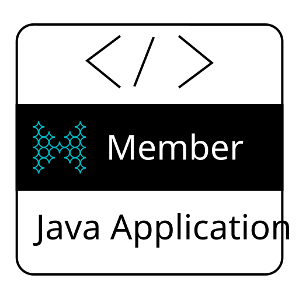
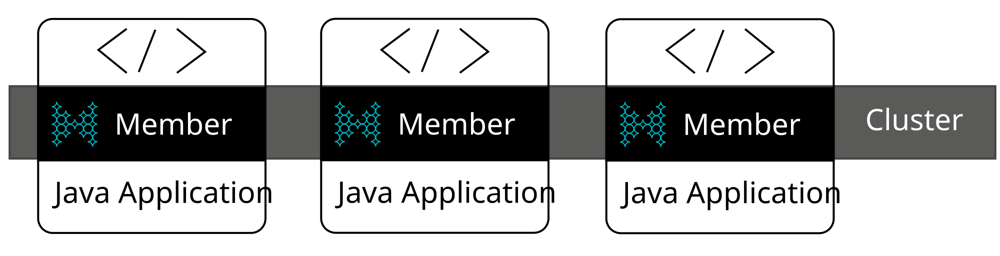
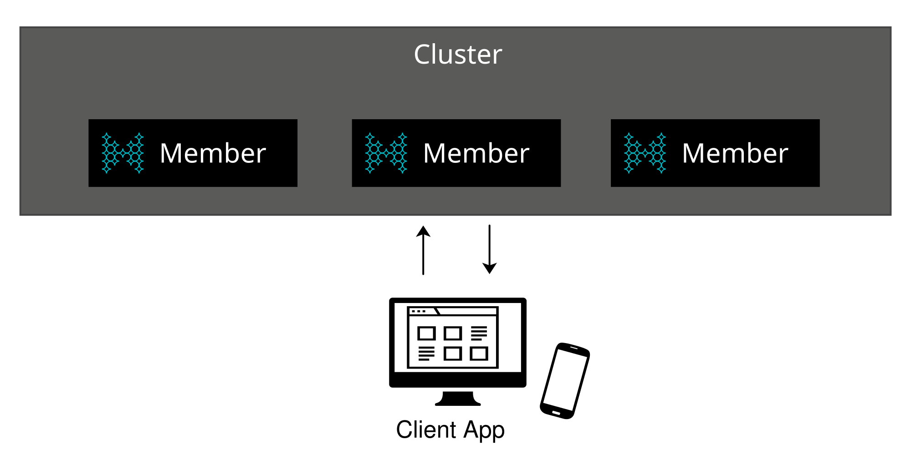

You can deploy Hazelcast in two topologies, depending on where you want the Hazelcast members to run:

- **Embedded mode:** Hazelcast members run in the same Java process as your application.
- **Client/server mode:** Hazelcast members run remotely outside your application, allowing you to scale them independently and connect to them through any of the supported clients.

:::tip

If you don't want to deploy your own self-managed cluster, try <Variable href="{url-cloud-signup}" text="Hazelcast {hazelcast-cloud}" />.

:::

## Comparing Topologies

This table compares embedded mode and client/server mode in terms of latency, scalability, and available programming languages.

<table>
<colgroup>
<col style={{width:'33.3333%'}} />
<col style={{width:'33.3333%'}} />
<col style={{width:'33.3334%'}} />
</colgroup>
<thead>
<tr>
<th></th>
<th>Embedded</th>
<th>Client/Server</th>
</tr>
</thead>
<tbody>
<tr>
<th>Low-latency</th>
<td>Yes</td>
<td>If used with [Near Cache](../../clients-and-apis/clients/java.mdx#configuring-client-near-cache) to store frequently used data in the client's local memory.</td>
</tr>
<tr>
<th>Scalability</th>
<td>The application and the cluster must be scaled together</td>
<td>You can scale the cluster independently of your application</td>
</tr>
<tr>
<th>Supported clients</th>
<td>Java</td>
<td>

- C++
- C\#
- Go
- Java
- Memcache
- Node.js
- Python
- REST

</td>
</tr>
</tbody>
</table>

## Embedded Mode

Hazelcast is written in Java, which means that Java developers can integrate, or embed, it as a library in their applications. This topology is called *embedded* mode.

All you need to do is add the Hazelcast JAR file to the application's classpath and start a member with the Java API. Then all the benefits of Hazelcast are available right inside the application.

In this mode, each instance of your application starts a Hazelcast member, and all members automatically form their own cluster. To interact with the cluster, you use a local member in your application.

If you are a Java developer working in an IDE, this is a convenient way to run a cluster on your development machine. There is nothing stopping you from starting your program several times to get a cluster on the same physical machine.

The main advantage of embedded mode is that all your Java classes are visible to Hazelcast. This way, you don't need to add classes to your members for tasks such as entry processing or submitting jobs.

[Get started with Hazelcast embedded](../../get-started/start-a-local-cluster/get-started-java.mdx).

## Client/Server Mode

In client/server mode, the Hazelcast cluster is independent of your application, which means that they can be independently scaled. To interact with the cluster, you use one of the available clients.

Client/server mode has advantages, including more predictable and reliable performance, easier identification of problem causes and, most importantly, better scalability. When you need to scale in this mode, just add more Hazelcast members. You can address client and server scalability concerns separately.

Client/server mode also provides higher availability. If there are any issues in running either your application or Hazelcast members, the issue and any potential failure is isolated from the rest of the application and members.

Get started with client/server:

- [Docker](../../get-started/start-a-local-cluster/get-started-docker.mdx)
- [CLI](../../get-started/start-a-local-cluster/get-started-cli.mdx)
- [Binary](../../get-started/start-a-local-cluster/get-started-binary.mdx)
