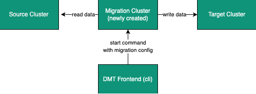

import Tabs from "@theme/Tabs";
import TabItem from "@theme/TabItem";

You can use the Data Migration Tool (DMT) to migrate your data from version 4.x or 5.x <Variable name="open-source-product-name" /> and <Variable name="enterprise-product-name" /> Hazelcast clusters when upgrading to 5.3.x or later versions of <Variable name="enterprise-product-name" />, or moving to the latest <Variable name="hazelcast-cloud" /> release. The DMT can also be used for infrastructure consolidation or separation with selective migration of application data between clusters.

:::note

The DMT migrates your data for maps and replicated maps only. Replicated map metadata is not migrated.

:::

The DMT is typically used in the following situations:

- When migrating from an <Variable name="open-source-product-name" /> cluster to an <Variable name="enterprise-product-name" /> cluster
- When migrating from an earlier version of <Variable name="enterprise-product-name" /> to a newer version. Such a migration can move directly between specified versions, even if several minor versions exist between them
- When migrating from an on-premise cluster to a self-managed <Variable name="enterprise-product-name" /> cluster in the cloud
- When migrating from an on-premise cluster to a <Variable name="hazelcast-cloud" /> cluster
- When you want to migrate specific application data from one cluster to another due to infrastructure changes

:::note

1. You cannot use the DMT to upgrade or migrate from IMDG 3.12.x. If you are upgrading from IMDG 3.12.x, see the [Upgrading from IMDG 3.12.x](../upgrading-from-imdg-3.mdx) topic. If migrating from IMDG 3.12.x, see [Migrating Data from IMDG 3.12.x](../migration-tool-imdg.mdx).
2. If you want to avoid downtime when upgrading members, use an in-place rolling upgrade instead of the DMT tool. For further information on upgrading without interrupting the operation of the cluster, see [Upgrade to a new version](../rolling-upgrades.mdx).
3. If you are moving members from a <Variable name="open-source-product-name" /> cluster to an <Variable name="enterprise-product-name" /> cluster, use an in-place rolling restart instead of the DMT tool. See [Upgrade to Enterprise Edition](./overview.mdx).
4. The DMT does not support migrating data serialized with [Compact Serialization](../../../develop-and-build/serialization/compact-serialization/overview.mdx).

:::

The DMT can be run on Mac, Linux, and Windows Operating Systems.

To use the DMT:

- The source cluster must be running and populated with required data
- The application must be using the source cluster
- The target cluster must be set up, but have no data

At a high-level, the migration process is as follows:

1. Set up the migration cluster
2. Shutdown all applications using the source cluster
3. Run the migration using the DMT command
4. Update the client configuration with the target cluster details
5. Restart the applications using the updated client configuration

## Get the DMT

You can download the DMT from the [Hazelcast download page](https://hazelcast.com/get-started/download/#data-migration-tool).

Once downloaded, extract the DMT package to a location in your folder structure. The DMT package includes the following:

- The DMT
- A custom Hazelcast distribution that creates a migration cluster and runs the data migration service
- Example configuration files
- Example connection configuration file, which is used to connect to the migration client

## Before You Begin

Ensure that you have installed the following:

- [Docker](https://docs.docker.com/get-docker/)
- <Variable href="/clc/{page-latest-supported-clc}/install-clc" text="Hazelcast Command-Line Client (CLC)^" />

When using the DMT, bear the following in mind:

- You can run only one migration at a time
- The target cluster must be on 5.3.x <Variable name="enterprise-product-name" /> or the latest <Variable name="hazelcast-cloud" /> release

:::note

<Variable name="hazelcast-cloud" /> Trial and <Variable name="hazelcast-cloud" /> Standard have a limit of 14GB of primary data. If you require more, you must use <Variable name="hazelcast-cloud" /> Dedicated. For further information on the available <Variable name="hazelcast-cloud" /> editions, refer to the <a href="https://docs.hazelcast.com/cloud/overview">Hazelcast <Variable name="hazelcast-cloud" /></a> documentation.

:::

- You must specify at least one data structure name in the migration configuration file
- All data structures specified in the migration configuration must exist in the source cluster
- Any populated data structures that already exist on the target cluster are not migrated; however, if the existing data structure is empty, it is migrated
- Any empty data structures are not migrated

## Migrate Your Data

To migrate your data, you must complete the following steps:

1. [Start the source cluster](#start-the-source-cluster)

   The source cluster is your existing cluster, the one that you want to migrate.

   :::note

   Hazelcast recommends that the source cluster is put in a `PASSIVE` state before you start the migration. This is because the DMT cannot guarantee that any data changed during migration will be migrated. For information on changing the state, see [Changing a Cluster's State](../../../operate-and-manage/maintaining-a-cluster/cluster-member-states.mdx#changing-a-clusters-state).

   :::

   If necessary, you can add data to the source cluster before continuing. For example, this can be done when testing a migration using a Development cluster. For further information on doing this, see the [Add Data to Cluster](#add-data-to-cluster) section.

   You must also update the configuration for the source cluster and related data structures. For further information on doing this, see the [Update the Source Configuration](#update-the-configuration) section.
2. [Check the target cluster](#check-the-target-cluster)

   The target cluster is the new cluster to which you want to migrate the source cluster.

   You must also update the configuration for the target cluster. For further information on doing this, see the [Update the Target Configuration](#update-the-target-conf) section.
3. [Start the migration cluster](#start-the-migration-cluster)

   The cluster created by the custom Hazelcast distribution.
4. Shut down any applications using the source cluster
5. [Run the Migration](#run-the-migration)
6. Update the client configuration with the target cluster details
7. [Verify the migrated data](#verify-the-migrated-data)

:::note

If you are using the DMT to test a migration, use a Development cluster when following the steps.

:::

The clusters work to migrate your data as illustrated below:



### Limited Migration Cluster License

A 10-node limited license is included for use with your migration cluster.

This license is valid for 30 days and can be used only for data migration and trial purposes.

### Start the Source Cluster

You can start your source cluster in either of the following ways:

- [Using Docker](#using-docker). This is the recommended method
- Downloading the version package, for the examples in the sections below we use [Hazelcast IMDG version 4.2.7](https://hazelcast.com/open-source-projects/downloads/archives/#hazelcast-imdg), and follow the IMDG [Quickstart](https://docs.hazelcast.com/imdg/4.2/getting-started)

#### Using Docker

To start your source cluster using Docker, you need the following information:

- The IP Address on which to start the cluster. This will be your internal Docker IP address
- The port to use. This will be your internal Docker port
- The version of Hazelcast

:::note

Ensure that the IP address you use for Docker is different to that used by any running processes on your local machine, such as the source cluster. In the sections below, we use `127.0.0.1:5701` for the source cluster and `172.12.0.1:5701` for the Docker container.

:::

The command has the following format:

```shell
docker run -p <ip_address_to_bind>:<host_port>:<container_port> -e HZ_CLUSTERNAME=source hazelcast/hazelcast:<source_version>
```

:::note

The `-p` option in the above command maps the container's port to the host machine. This ensures that your Docker instance, which is running in a virtual network, is accessible to your local processes. The option is required because the migration and target clusters, CLC, and DMT run locally on your computer outside the Docker environment.

:::

For example, to start a version 4.2.7 source cluster on IP address 127.0.0.1 and port 5701, enter the following command in a terminal:

```shell
docker run -p 127.0.0.1:5701:5701 -e HZ_CLUSTERNAME=source hazelcast/hazelcast:4.2.7
```

#### Add Data to Cluster

To access the cluster and populate it with data - for example, because you are using the DMT to test a migration of a Development cluster - you can do either of the following:

- Use the *source.yaml* configuration file, included in the *migration\_config* folder of the DMT download package
- Write data to memory as described in the [Step 3. Write Data to Memory](../../../get-started/start-a-local-cluster/get-started-binary.mdx#step-3-write-data-to-memory) section of this documentation

The *source.yaml* file contains the following:

```yaml
cluster:
  name: "source"
  address: "127.0.0.1:5701"
```

:::note

If you have not installed the Hazelcast CLC, do this now. For further information on installing the CLC, refer to the <Variable href="/clc/{page-latest-supported-clc}/install-clc" text="Hazelcast Command-Line Client^" /> documentation.

:::

To make sure that you can add an entry to the source cluster, enter the following command in a terminal:

```shell
clc -c source.yaml map --name my-map set key-1 value-1
```

If an error relating to CLC being unable to connect to your source cluster is returned, confirm the following:

- The port mapping is correct
- The source cluster container is running
- The configuration in your *source.yaml* file is correct

If no errors are returned, you can populate the source cluster with 1000 entries using the following script:

<Tabs groupId="macos-and-linux--windows">
<TabItem value="macos-and-linux" label="macOS and Linux">

```shell
for i in {1..1000}; do clc -c source.yaml map --name my-map set key-$i value-$i --quiet; done && echo OK
```

</TabItem>
<TabItem value="windows" label="Windows">

```shell
for /l %x in (1, 1, 1000) do clc -c source.yaml map --name my-map set key-%x value-%x --quiet
```

</TabItem>
</Tabs>

#### Update the Source Configuration

You must update the following configuration:

- The cluster information
- The data structure information

To update the cluster information, complete the following steps:

1. Navigate to the folder in which you extracted the DMT package
2. Open the *migration\_config/source/hazelcast.yaml* file in your favorite editor

   :::note

   The *hazelcast.yaml* file is a Hazelcast client configuration file, which can include any supported configuration.

   :::
3. Update the `cluster-name` field to match the name of your source cluster
4. Update the `cluster-members` field to match the addresses of the cluster members
5. Save the file

To update the data structure information, complete the following steps:

1. Navigate to the folder in which you extracted the DMT package
2. Open the *migration\_config/data/imap\_names.txt* and/or the *migration\_config/data/replicated\_map\_names.txt* file in your favorite editor
3. Update the file content to match the names of your maps. To select multiple data structures using a single entry, you can use wildcards. For further information on using wildcards, see the [Using Wildcards](../../../operate-and-manage/configuration/static-configuration/using-wildcards.mdx) topic.

   :::note

   If you have multiple data structures, use a new line for each map name.

   :::
4. Save the file

### Check the Target Cluster

Ensure that the target cluster is running on one of the following:

- <Variable name="enterprise-product-name" /> version 5.3.2 or later
- <Variable name="hazelcast-cloud" />

#### Update the Target Configuration

You must update the following configuration:

- The cluster
- The connection
- If required, SSL

To update the target configuration, complete the following steps:

1. Navigate to the folder in which you extracted the DMT package
2. Open the *migration\_config/target/hazelcast-client.yaml* file in your favorite editor

   :::note

   The *hazelcast-client.yaml* file is a Hazelcast client configuration file, which can include any supported configuration.

   :::
3. Update the `cluster-name` field to match the name of your source cluster
4. Update the `network` section as follows:

   - For an on-premise target cluster, update the `cluster-members` field to match the addresses of the cluster members
   - For a cloud target cluster, including a <Variable name="hazelcast-cloud" /> cluster, update the network information. For a public cloud cluster, refer to the documentation for the cloud provider for the required network details. For <Variable name="hazelcast-cloud" />, you must update the network section as follows:

     ```
     hazelcast-client:
       :
       network:
         hazelcast-cloud:
           enabled: true
           discovery-token: <token>
     ```
5. If required, add the `ssl` information. The format is as follows:

   ```
   hazelcast-client:
     :
     network:
     :
       ssl:
         enabled: true
         properties:
           keyStore: client.keystore
           keyStorePassword: abc123
           trustStore: client.truststore
           trustStorePassword: abc123
   ```
6. Save the file

:::note

For further information on the `ssl` properties and their values, refer to the [Using Advanced Setup](https://docs.hazelcast.com/cloud/connect-to-cluster#advanced) section in the Hazelcast <Variable name="hazelcast-cloud" /> documentation.

:::

For example, the file content for a cloud target cluster will look similar to the following:

```
hazelcast-client:
  cluster-name: xyz
  network:
    hazelcast-cloud:
      enabled: true
      discovery-token: tokentoken
    ssl:
      enabled: true
      properties:
        keyStore: client.keystore
        keyStorePassword: abc123
        trustStore: client.truststore
        trustStorePassword: abc123
```

### Start the Migration Cluster

To start the migration cluster, complete the following steps:

1. Open a terminal
2. Navigate to the folder in which you extracted the DMT package
3. Enter the following command:

   ```shell
   HZ_NETWORK_PORT_PORT=5702 HZ_CLUSTERNAME=migration ./bin/hz start
   ```

If the specified port is available, the cluster starts on that port. Otherwise, Hazelcast tries to find a free port as described in the [Port](../../../operate-and-manage/partition-groups-and-networking/network-configuration.mdx#port) section of the Networking topic. You can confirm the port used by the cluster in the logs displayed in your terminal.

You can find the *migration.yaml* file in the root folder of the DMT download package. If your logs show that the cluster starts on a different port to that specified in this file, you must update the `address` field to match the port number used.

DMT uses this configuration file to connect to the migration cluster when running the migration.

:::note

The *migration.yaml* file uses the same configuration options as the Hazelcast CLC. For further information on the options, refer to the <Variable href="/clc/{page-latest-supported-clc}/clc-config" text="Hazelcast CLC documentation^" />.

:::

### Run the Migration

Before running the migration, you need the following information:

- Your Operating System
- Your processor architecture
- The binary that is suitable for your machine

You can find DMT binaries in the *bin* folder of the extracted DMT package. The binaries are in the format `dmt_[platform]_[arch]`. Use the `arm64` binary for ARM, and the `amd64` binary for Intel.

To run the migration, complete the following steps:

1. Open a terminal
2. Navigate to the folder containing the extracted DMT package
3. Enter the following command:

   ```shell
   ./bin/dmt_[platform]_[arch] --config migration.yaml start migration_config --yes --log.path migration.log
   ```

:::note

1. `--log.path migration.log` specifies that the migration logs are saved to the *migration.log* file on completion of the migration. For further information on viewing the migration details, see the [View Migration Results](#view-result)
2. The DMT will attempt to connect to the migration cluster indefinitely. This means that it can appear to hang if unable to connect. To avoid this, you can set a timeout for the connection attempt using the `--timeout` flag. For further information on the `--timeout` flag, refer to the <Variable href="/clc/{page-latest-supported-clc}/configuration#clc-configuration-with-command-line-parameters" text="CLC Configuration with Command-line Parameters^" /> section of the Hazelcast CLC documentation.
3. On MacOS, you might need to allow the `dmt*` binary to run. If the command is rejected, go to the **Privacy & Security** settings on your device and update them to allow the binary. After updating the settings, retry the command, and select **Open** when prompted

:::

You can use the DMT `status` command to track the migration. For further information on the available DMT commands, see the [DMT Command Reference](./dmt-command-reference.mdx).

### Verify the Migrated Data

You can verify the size of the map in the target cluster in the following ways:

- Use the Hazelcast Management Center

  To use the Hazelcast Management Center, you can use either of the following methods:

  - Check the target map size, as described in the <Variable href="/management-center/{page-latest-supported-mc}/data-structures/map" text="Maps" /> section of the Hazelcast Management Center documentation
  - Check the map entries, as described in the <Variable href="/management-center/{page-latest-supported-mc}/data-structures/map#map-browser" text="Exploring Map Entries" /> section of the Hazelcast Management Center documentation
- Use Hazelcast CLC

  To use Hazelcast CLC to verify the migrated map size, enter the following command in your terminal:

  ```shell
  clc -c target.yaml map size --name my-map
  ```

  The output is similar to the following

  ```shell
  1000
  OK
  ```

You can also check a random value from the data we populated in the [Add Data to Cluster](#add-data-to-cluster) section above using the following command:

```shell
clc -c target.yaml map get key-42 --name my-map
```

The output is similar to the following:

```shell
value-42
OK
```

### View Migration Details

When the migration completes, details of the migration are created in the following:

- Migration report

  This is written to the *migration\_report\_\[migration\_id\].txt* file in the directory used when running the `dmt` command.
- DMT log file

  This is the file specified in the `--log.path` flag of the `start` command.

  If the flag is not used, the file is saved to the location set in the `CLC_HOME` environment variable. If this environment variable is not set, the default location is the *~/.hazelcast* folder.

  :::note

  Logging uses the same environment variables as Hazelcast CLC. For further information on environment variables, refer to the <Variable href="/clc/{page-latest-supported-clc}/environment-variables" text="Environment Variables^" /> section of the Hazelcast CLC documentation.

  :::

  The DMT log file includes migration member logs and other DMT logs.

  The migration member logs are in the format `[(migration_id)_(member uuid)] (member log)`.
- `__datamigration_results` IMap

  This is created on the target cluster.

  The keys are UUID4 string format migration IDs, and the values are `HazelcastJsonValue` serialization interfaces that correspond to migration statuses. A migration status represents the details of the completed migration, and can be provided when contacting Hazelcast Support to help us in our investigations into your issue.

  The migration report is also included as a field.
