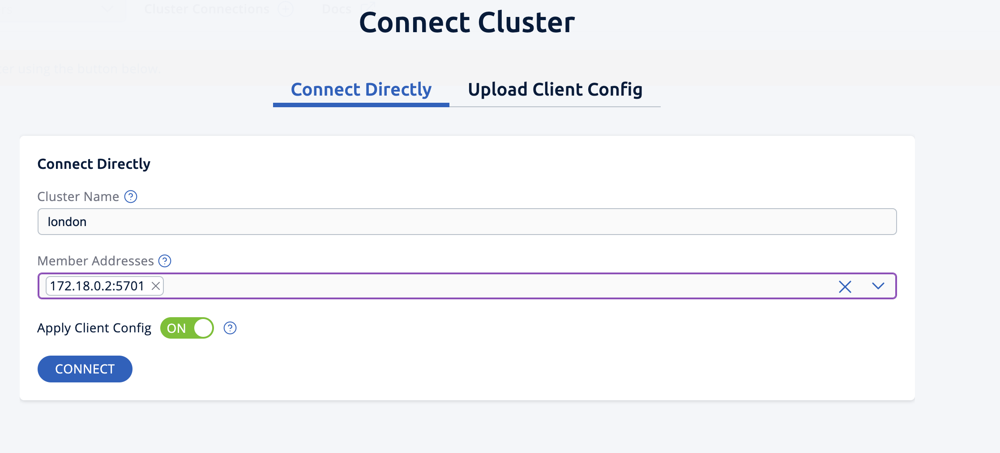
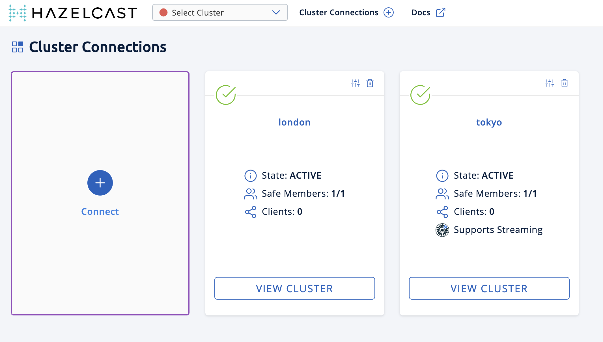
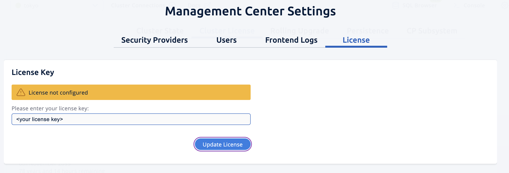
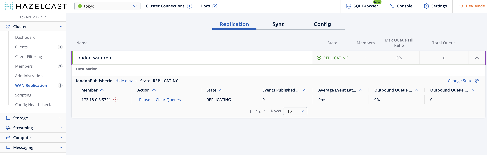
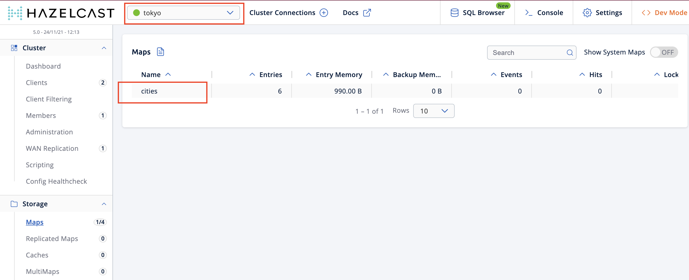
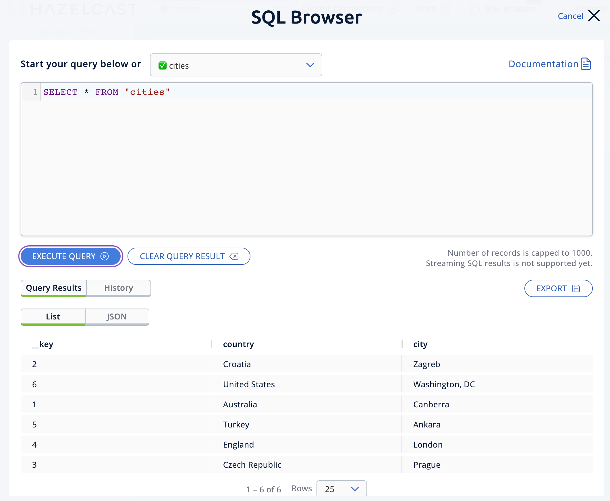
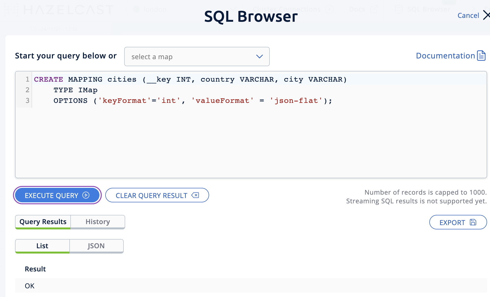
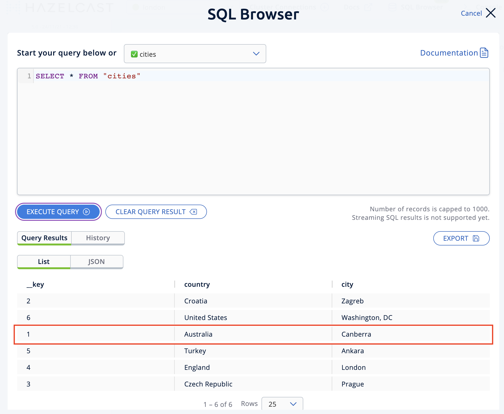
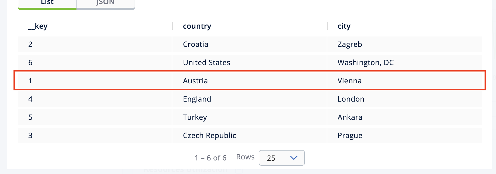

import Tabs from "@theme/Tabs";
import TabItem from "@theme/TabItem";

This tutorial introduces you to WAN Replication (also known as Geo-Replication) by showing how to replicate map entries across two clusters.

## Overview

In this tutorial, you'll do the following:

- Start a passive cluster, which will receive updates from the active cluster.
- Start an active cluster with WAN Replication, which will send updates to the passive cluster.
- Create a map in the active cluster and check entries are replicated on the passive cluster.
- Modify some map entries in the active cluster and see the changes replicated in the passive cluster.

:::note

WAN Replication can work in two modes. This tutorial uses active-passive mode, which means an active cluster replicates its maps and/or caches to one or more passive clusters for the purpose of maintaining a backup. If the active cluster becomes unavailable, the application traffic is automatically redirected to the passive cluster. In contrast, in active-active mode each cluster replicates maps and/or caches to all other clusters.

:::

The tutorial should take approximately 15 minutes to complete.

## Prerequisites

Before you start this tutorial, ensure you have completed the following:

- [Get started with Hazelcast Enterprise Edition](../../get-started/get-started-enterprise/overview.mdx)

## Step 1: Start the passive cluster

In this step, you'll start an <Variable name="enterprise-product-name" /> cluster called `London` with a single member. This will be the **passive** cluster, which means it doesn't need WAN Replication to be enabled.

1. Run the following Docker command in a terminal, replacing the \<YOUR\_LICENSE\_KEY\> placeholder with your Hazelcast Enterprise Edition license key:

   ```shell conums vars
   docker run \
       -p 5701:5701 \
       --network hazelcast-network \
       -e HZ_NETWORK_PUBLICADDRESS=host.docker.internal:5701 \ <1>
       -e HZ_LICENSEKEY=<YOUR_LICENSE_KEY> \ <2>
       -e HZ_MANAGEMENTCENTER_CONSOLEENABLED=true \
       -e HZ_CLUSTERNAME=London \
       hazelcast/hazelcast-enterprise:{ee-version}
   ```

   <CodeCallouts>

   1. You can replace `host.docker.internal` with the IP address of your Docker host. Either method will work but you will need to know the IP address for the later step connecting, for example, a SQL client to a specific member.
   2. Replace the `<YOUR_LICENSE_KEY>` placeholder with the Hazelcast <Variable name="enterprise-product-name" /> license key.

   </CodeCallouts>

You should see confirmation that looks like:

```shell vars
2024-11-23 11:08:15,055 [ INFO] [main] [c.h.i.c.ClusterService]: [host.docker.internal]:5701 [London] [{ee-version}]

Members {size:1, ver:1} [
	Member [host.docker.internal]:5701 - bed20746-1505-449b-9f4a-548bcdbe12b8 this
]
```

## Step 2: Start the active cluster

In this step, you'll start another <Variable name="enterprise-product-name" /> cluster called `Tokyo` with a single member. This will be the **active** cluster which means it needs WAN Replication to be configured.

:::note

This section shows you how to create a Hazelcast configuration file and use Docker to start Hazelcast, instead of providing all the configuration options in a single command.

:::

1. Create a `hazelcast.yaml` (or XML) configuration file in a `~/config-tokyo` directory, replacing the \<YOUR\_LICENSE\_KEY\> placeholder:

   <Tabs groupId="config-format">
   <TabItem value="yaml" label="YAML">

   ```yaml conums
   hazelcast:
     cluster-name: Tokyo
     license-key: <YOUR_LICENSE_KEY>
     jet:
       enabled: true
     wan-replication: <1>
       london-wan-rep:
         batch-publisher:
           londonPublisherId:
             cluster-name: London
             target-endpoints: host.docker.internal:5701
     map:
       cities: <2>
         wan-replication-ref:
           london-wan-rep: <3>
             republishing-enabled: false
   ```

   <CodeCallouts>

   1. Enables WAN Replication and creates the connection to the London cluster.
   2. Defines the name of the map we're going to replicate i.e. `cities`.
   3. Configures the map to use the `wan-replication` defined in \<1\>. If you wanted to replicate multiple maps, you could add other `map` entries here.

   </CodeCallouts>

   </TabItem>
   <TabItem value="xml" label="XML">

   ```xml conums
   <hazelcast>
       <cluster-name>Tokyo</cluster-name>
       <license-key><YOUR_LICENSE_KEY></license-key>
       <jet enabled="true" />
       <wan-replication name="london-wan-rep"> <1>
           <batch-publisher>
               <cluster-name>London</cluster-name>
               <publisher-id>londonPublisherId</publisher-id>
               <target-endpoints>host.docker.internal:5701</target-endpoints>
       <map name="cities"> <2>
           <wan-replication-ref name="london-wan-rep"> <3>
       </map>
   </hazelcast>
   ```

   <CodeCallouts>

   1. Enables WAN Replication and creates the connection to the London cluster.
   2. Defines the name of the map to be replicated i.e. `cities`.
   3. Configures the map to use the `wan-replication` defined in \<1\>. If you wanted to replicate multiple maps, you could add other `map` entries here.

   </CodeCallouts>

   </TabItem>
   </Tabs>
2. Open a new terminal and start the active cluster as follows:

   ```shell vars
   docker run \
        --network hazelcast-network \
        -e JAVA_OPTS="-Dhazelcast.config=/opt/hazelcast/config_ext/hazelcast.yaml" -v ~/config-tokyo:/opt/hazelcast/config_ext hazelcast/hazelcast-enterprise:{ee-version}
   ```

   :::note

   This code example uses `~/config` as the path to the directory containing the configuration file created in step 1. If you saved the configuration file somewhere else, you need to update this path.

   :::

   You should see confirmation like:

   ```shell vars
   2024-11-23 11:39:14,198 [ INFO] [main] [c.h.i.c.ClusterService]: [172.18.0.3]:5701 [Tokyo] [{ee-version}]

   Members {size:1, ver:1} [
   	Member [172.18.0.3]:5701 - 98d9a815-5eb3-4341-bec1-e9816cee44b5 this
   ]
   ```
3. Note the member IP address and port for connecting to this cluster later via Management Center.

## Step 3: Set up Management Center

The next step is connecting to the clusters using Management Center and adding the license key so you can enable WAN Replication.

1. Open a new terminal and start Management Center using the following code:

   ```shell vars
   docker run \
       --network hazelcast-network \
       -p 8080:8080 hazelcast/management-center:{page-latest-supported-mc-installer}
   ```
2. Open a web browser and go to `localhost:8080`.
3. Enable **Dev Mode** and click **Connect**.
4. Enter the passive cluster's name (`London`) and the IP address and port e.g. `host.docker.internal:5701`.

    Management Center connection details for the `London` cluster.
5. Click **Connect** again and enter the active cluster's name (`Tokyo`) and the IP address and port e.g. `172.18.0.3:5701`.

    Management Center connections active to both clusters.
6. Select **Tokyo** from the **Cluster** dropdown in the Top Menu.
7. Open the **Settings** window from the top right of the screen.
8. Select the **License** tab, paste your Enterprise license key in and click **Update License**.

    Add your license key to enable this Enterprise feature.
9. You can verify that the `Tokyo` cluster has WAN Replication enabled by clicking **Cluster \> WAN Replication**.

   

## Step 4: Create a map

In this step you'll use the SQL shell to create a map called `cities` for the Tokyo cluster, and add data to it.

1. In a new terminal, start the SQL shell for the Tokyo cluster, replacing the IP address if needed i.e. this example assumes Tokyo is running on `172.18.0.3:5701`:

   ```shell vars
   docker run --network hazelcast-network -it --rm hazelcast/hazelcast-enterprise:{ee-version} hz-cli --targets Tokyo@172.18.0.3:5701 sql
   ```
2. When you see the SQL shell prompt (`sql>`), type the following command and press <kbd>Enter</kbd> to create the map:

   ```sql
   CREATE MAPPING cities (__key INT, country VARCHAR, city VARCHAR)
   TYPE IMap
   OPTIONS ('keyFormat'='int', 'valueFormat' = 'json-flat');
   ```
3. Next, add city data to the map as follows:

   ```sql
   INSERT INTO cities VALUES
   (1,'Australia','Canberra'),
   (2,'Croatia','Zagreb'),
   (3,'Czech Republic','Prague'),
   (4,'England','London'),
   (5,'Turkey','Ankara'),
   (6,'United States','Washington, DC');
   ```
4. You can confirm the entries have been added to the map by running:

   ```sql
   SELECT * FROM cities;
   ```
5. You can also see the map and its entries in Management Center, using the SQL browser. Select **Tokyo** from the **Cluster** dropdown in the Top Menu.
6. Click **Storage** \> **Maps** and check you can see the `cities` map:

   
7. Click **SQL Browser** from the left-hand **Tools** menu and enter `SELECT * FROM cities;` as your query.
8. Click **Execute Query** and you should see your newly created map containing the city data.

   
9. Close the SQL browser.

## Step 5: Verify the map is replicating

With WAN Replication enabled, your `cities` map and its data should be replicated from the active Tokyo cluster to the passive London cluster. This section shows you how to check this.

1. Select **London** from the **Cluster** dropdown in the Top Menu.
2. Click **Storage** \> **Maps** and check you can see the `cities` map.
3. You can query the map entries on the `London` cluster using the SQL browser in Management Center. First, you need to create a mapping so that the `London` cluster can read the map entries. Open the SQL Browser again and select the **Connector Wizard**.
4. Enter the following query and click **CONFIRM AND RUN**:

   ```sql
   CREATE MAPPING cities (__key INT, country VARCHAR, city VARCHAR)
   TYPE IMap
   OPTIONS ('keyFormat'='int', 'valueFormat' = 'json-flat');
   ```
5. You should see confirmation the mapping is successful and you can **Close** the Connector Wizard.

   
6. You can now enter the `SELECT * FROM cities;` query into the SQL Browser and **Execute** to see the replicated `cities` map.
7. Close the SQL Browser.

## Step 6: Update a map entry on the active cluster

In this step, you'll update an entry in the `cities` map on the active cluster (`Tokyo`) and verify the update is replicated to the passive one (`London`).

1. Select **London** from the **Cluster** dropdown in the Top Menu and open the SQL Browser again.
2. Choose **cities** in the **select a map** field and execute the default `SELECT * FROM "cities"` query:

   
3. Update one of the map entries using the following query:

   ```sql
   SINK INTO cities VALUES
   (1, 'Austria', 'Vienna');
   ```

   Execute the query and confirm the entry has changed (from Australia to Austria).

   
4. Close the SQL Browser and select the passive cluster (`London`) from the **Cluster** dropdown.
5. Open the SQL Browser again, choose **cities** in the **select a map** field and execute the default query.
6. You should be able to see the `1` \_key entry updated through replication.

In this step, you have seen that a data modification in the active cluster is immediately replicated to the passive cluster.

:::tip

As an additional learning step, you could try modifying the map data on the passive cluster and confirming the change is not replicated on the active cluster.

:::

## Step 7: Shut down the cluster

As an alternative to terminating the clusters via the terminal, you can use Management Center to shut down clusters. For each cluster:

1. Go to **Cluster** \> **Administration**, and select the **Cluster State** tab.
2. Click **Shutdown** and confirm the dialog that appears.

## Summary

In this tutorial, you learned how to:

- Start a passive <Variable name="enterprise-product-name" /> cluster.
- Start an active cluster with WAN Replication.
- Create a map in the active cluster and confirm it's replicated.
- Modify some map entries in the active cluster and see the changes replicated in the passive cluster.

## Next steps

Learn more about [Synchronizing Data Across Clusters](./wan-replication-tutorial.mdx) or follow another tutorial in this series:

- [Authenticate client connections](../../get-started/get-started-enterprise/authenticate-client-tutorial.mdx)
- [Deploy blue-green clusters](../../get-started/get-started-enterprise/deploy-blue-green-tutorial.mdx)
