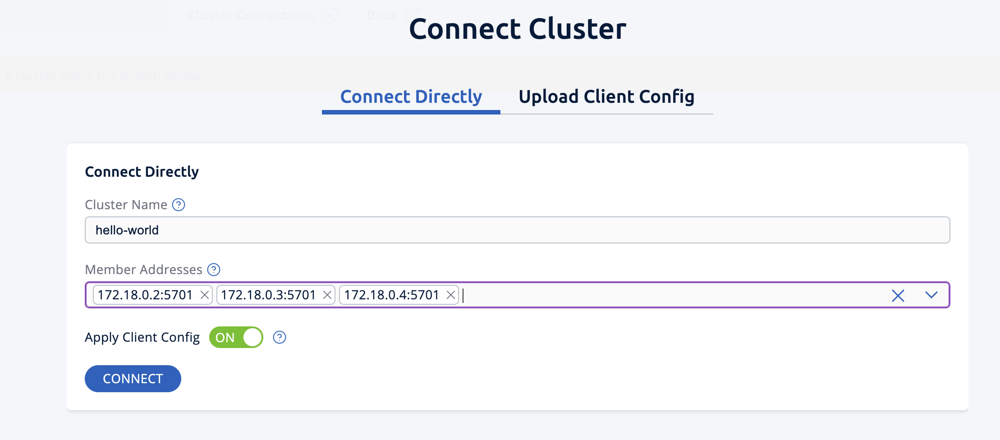
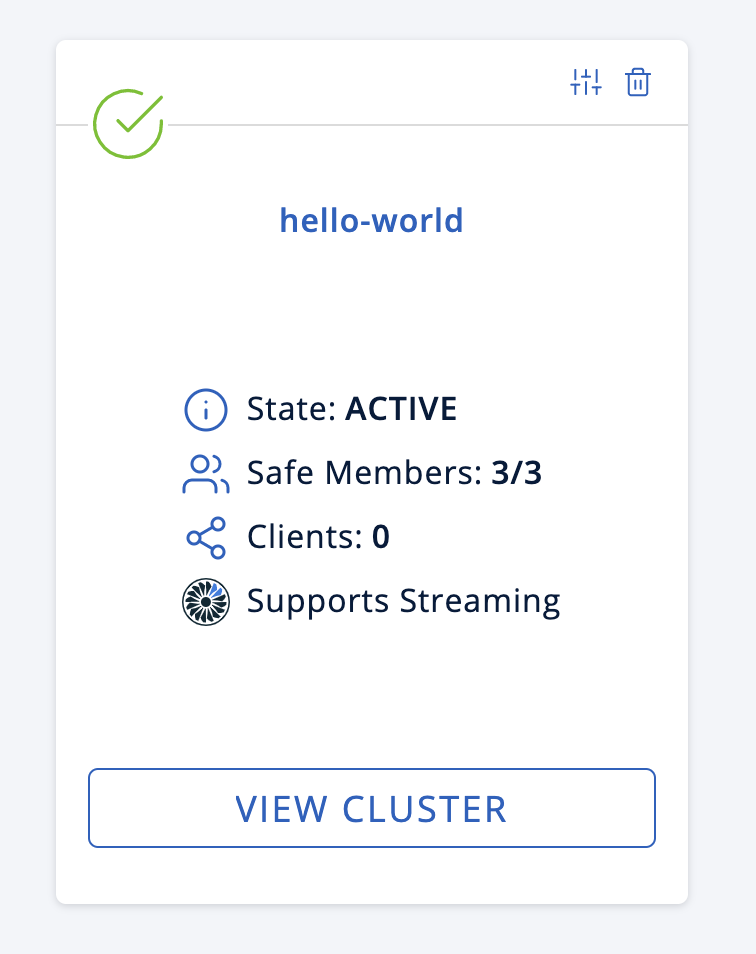
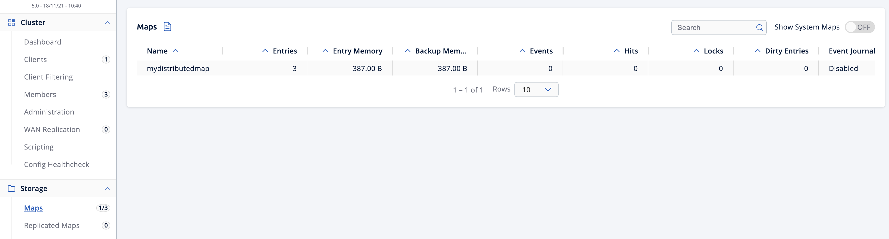

import PartialGettingStartedInstallEnterprise from "@site/hazelcast_versioned_docs/version-6.1/_partials/getting-started-install-enterprise.mdx";

This quickstart tutorial will get you started with Hazelcast Platform <Variable name="enterprise-product-name" /> and take you from installation all the way through to a working three member cluster with persistence enabled.

## Overview

In this tutorial, you'll do the following:

- Install Hazelcast Enterprise with a trial license.
- Create a cluster with three members with persistence enabled.
- Create a map and view the data in Management Center.
- Restart the cluster and check the data persists.

The tutorial should take approximately 20 minutes to complete.

## Step 1: Pull the Hazelcast <Variable name="enterprise-product-name" /> Docker image {/* #step-1-pull-the-hazelcast-enterprise-edition-docker-image */}

<PartialGettingStartedInstallEnterprise />

## Step 2: Get your <Variable name="enterprise-product-name" /> license {/* #step-2-get-your-enterprise-edition-license */}

Hazelcast <Variable name="enterprise-product-name" /> requires a license key. You can get a trial license from the [Hazelcast website](https://hazelcast.com/get-started?utm_source=docs-website).

1. Complete the form on the [Hazelcast website](https://hazelcast.com/get-started?utm_source=docs-website)
2. Check your email for an automated email from [info@hazelcast.com](mailto:info@hazelcast.com)
3. You should have a license key that looks like:

   ```shell
   TrialLicense#10Nodes#eyJhbGxvd2VkTmF0aXZlTWVtb3J5U2l6ZSI6MTAwLCJhbGxvd2VkTnVtYmVyT2ZOb2RlcyI6MTAsImFsbG93ZWRUaWVyZWRTdG9yZVNpemUiOjAsImFsbG93ZWRUcGNDb3JlcyI6MCwiY3JlYXRpb25EYXRlIjoxNzUyMTU0ODYzLjMxODUyNzg2MSwiZXhwaXJ5RGF0ZSI6MTc1NDY5NzU5OS45OTk5OTk5OTksImZlYXR1cmVzIjpbMCwyLDMsNCw1LDYsNyw4LDEwLDExLDEzLDE0LDE1LDE3LDIxLDIyXSwiZ3JhY2VQZXJpb2QiOjAsImhhemVsY2FzdFZlcnNpb24iOjk5LCJvZW0iOmZhbHNlLCJ0cmlhbCI6dHJ1ZSwidmVyc2lvbiI6IlY3In0=.enSTWffnYK_rBdTC7LOVISPYYaEfwdM7giv8ZBH4iq2b5vHuA5U-OswteJUmF8jHXyyo9j0oKBWkvgxe6PBKAQ==
   ```

   In any provided code examples in this documentation, you should replace any instances of \<YOUR\_LICENSE\_KEY\> with your specific license key.

## Step 3: Create Docker network for Hazelcast

1. Create a Docker network for Hazelcast, using the following command:

   ```shell
   docker network create hazelcast-network
   ```

   You should see a confirmation message (showing the full NETWORK ID) similar to this:

   ```shell
   fdf9adf0a3795bfdfb6944b9816d873d30a56d5a94b6b0c0964ce3bce5ec4819
   ```

   If you have run this command previously (and not deleted the network), you will see confirmation that `network with name hazelcast-network already exists`.

## Step 4: Start a member with persistence enabled

1. To start the first member in a cluster called `hello-world`, replace the \<YOUR\_LICENSE\_KEY\> placeholder and run the following Docker command:

   ```shell conums vars
   docker run \
       --name first-member --network hazelcast-network \
       --rm \
       -e HZ_NETWORK_PUBLICADDRESS=host.docker.internal:5701 \ <1>
       -e HZ_CLUSTERNAME=hello-world \
       -e HZ_LICENSEKEY=<YOUR_LICENSE_KEY> \ <2>
       -e HZ_PERSISTENCE_ENABLED=true \
       -e HZ_MAP_MYDISTRIBUTEDMAP_DATAPERSISTENCE_ENABLED=true \
       -v ~/persist:/opt/hazelcast/persistence \ <3>
       -p 5701:5701 hazelcast/hazelcast-enterprise:{ee-version} <4>
   ```

   <CodeCallouts>

   1. You can replace `host.docker.internal` with a specific IP address if you prefer but make sure you adjust the following code examples accordingly.
   2. Replace the `<YOUR_LICENSE_KEY>` placeholder with the Hazelcast <Variable name="enterprise-product-name" /> license key from step 2.
   3. By default, Hazelcast creates the `/opt/hazelcast/persistence` directory to store the persisted data. However, using a Docker image, you cannot create any files inside the container. This line of the command mounts a directory on your local drive to the container, which in this case is `persist` under the home directory. This way, the container will use this local directory to save the persisted data. You need to define a separate persist mapping for each member e.g. the second member example below uses `~/persist2`.
   4. The first port number should match the port assigned in \<1\>. For subsequent members (e.g. second, third), you should increment the first port number but keep the second port number i.e. 5702:5701, 5703:5701.

   </CodeCallouts>

Your first member should started, and you should see from the terminal logs that persistence is enabled:

```shell vars
[ INFO] [main] [c.h.i.c.o.ExternalConfigurationOverride]: Detected external configuration entries in environment variables: [hazelcast.persistence.enabled=true,hazelcast.clustername=hello-world,hazelcast.licensekey=,hazelcast.map.mydistributedmap.datapersistence.enabled=true]
[ INFO] [main] [c.h.i.h.HotRestartIntegrationService]: [LOCAL] [hello-world] [{full-version}] Created new empty hot-restart directory: /opt/hazelcast/persistence/611ffa80-b653-44b9-8cf1-f9ffa5bfa1cb
[ INFO] [main] [c.h.s.logo]: [172.18.0.2]:5701 [hello-world] [{ee-version}]
```

## Step 5: Start more members

Run each of the following Docker commands in a separate terminal, replacing the `<YOUR_LICENSE_KEY>` placeholders with your Hazelcast <Variable name="enterprise-product-name" /> license key:

1. Open a **new** terminal window and run the following command to start a second member:

   ```shell vars
   docker run \
       --name second-member --network hazelcast-network \
       --rm \
       -e HZ_NETWORK_PUBLICADDRESS=host.docker.internal:5702 \
       -e HZ_CLUSTERNAME=hello-world \
       -e HZ_LICENSEKEY=<YOUR_LICENSE_KEY> \
       -e HZ_PERSISTENCE_ENABLED=true \
       -e HZ_MAP_MYDISTRIBUTEDMAP_DATAPERSISTENCE_ENABLED=true \
       -v ~/persist:/opt/hazelcast/persistence \
       -p 5702:5701 hazelcast/hazelcast-enterprise:{ee-version}
   ```
2. Open another **new** terminal window and run the following command to start a third member:

   ```shell vars
   docker run \
       --name third-member --network hazelcast-network \
       --rm \
       -e HZ_NETWORK_PUBLICADDRESS=host.docker.internal:5703 \
       -e HZ_CLUSTERNAME=hello-world \
       -e HZ_LICENSEKEY=<YOUR_LICENSE_KEY> \
       -e HZ_PERSISTENCE_ENABLED=true \
       -e HZ_MAP_MYDISTRIBUTEDMAP_DATAPERSISTENCE_ENABLED=true \
       -v ~/persist:/opt/hazelcast/persistence \
       -p 5703:5701 hazelcast/hazelcast-enterprise:{ee-version}
   ```

You should see all three members forming a cluster, with confirmation that looks like:

```shell conums
Members {size:3, ver:3} [
	Member [host.docker.internal]:5701 - d1917f97-49b4-4e8e-b8df-ab541c6c681b this  <1>
	Member [host.docker.internal]:5702 - ed7d90a0-1819-40fc-a0fb-da64a43d9269
	Member [host.docker.internal]:5703 - a7f2f072-cb1f-4c15-88b3-6dbefa212bb0
]
```

<CodeCallouts>

1. The **this** label at the end of the line indicates the current member i.e. this example shows Hazelcast logs from the first member's perspective.

</CodeCallouts>

## Step 6: Create a map

In this step, you'll create a map called `mydistributedmap` with three entries.

1. In a **new** terminal window, use the following code to start the SQL shell:

   ```shell vars
   docker run --network hazelcast-network -it --rm hazelcast/hazelcast-enterprise:{ee-version} hz-cli --targets hello-world@host.docker.internal sql
   ```
2. Create the map:

   ```sql
   CREATE MAPPING mydistributedmap TYPE IMap OPTIONS ('keyFormat'='varchar','valueFormat'='varchar');
   ```
3. Add data to the map:

   ```sql
   SINK INTO mydistributedmap VALUES
   ('1', 'John'),
   ('2', 'Mary'),
   ('3', 'Jane');
   ```
4. Exit the SQL shell using the `exit` command.

## Step 7: View the map in Management Center

1. Open another **new** terminal and start Management Center using the following command:

   ```shell vars
   docker run \
       --network hazelcast-network \
       -p 8080:8080 hazelcast/management-center:{page-latest-supported-mc-installer}
   ```
2. In a web browser, go to `localhost:8080` and enable Dev Mode.
3. You should now see a **Cluster Connections** screen.

   1. Click **Connect Cluster**.
   2. Enter a **Cluster Name** of `hello-world`.
   3. Enter a **Member Address** of `host.docker.internal:5701`.
   4. Click **Connect** to connect to the cluster.

      
4. You may have to wait 10 seconds or so for the cluster to show as active and with three members.

   
5. Click **View Cluster** and go to **Storage \> Maps**. You'll see the map you created has data with three entries. If you want to view the details for `mydistributedmap`, enable the **Map Statistics** box.

   

## Step 8: Restart the cluster

1. Go to **Cluster** \> **Administration**, and select the **Cluster State** tab.
2. Click **Shutdown** and confirm the dialog that appears.

   Management Center should now show it is disconnected from the cluster, which you can confirm by checking your terminal windows, which will show the members exited to shell and similar output to:

   ```shell vars
   2025-07-18 15:21:50,538 [ INFO] [hz.eloquent_cannon..clusterShutdown] [c.h.i.i.Node]: [host.docker.internal]:5702 [hello-world] [{full-version}] Hazelcast Shutdown is completed in 124 ms.
   ```
3. Restart the cluster by starting the members up again, by rerunning the commands in steps 4 and 5 above.
4. When the members have restarted, you can view your map data in Management Center and confirm the entries still exist. If persistence was not enabled, the data would be lost after cluster shutdown.

## Step 9: Clean up

1. Repeat the steps above to shut down the cluster
2. To delete the persist directories created above, use the following command:

   ```shell
   rm -rf ~/persist*
   ```

## Summary

In this tutorial, you learned how to:

- Deploy Hazelcast <Variable name="enterprise-product-name" /> with persistence enabled.
- Create a simple Hazelcast map using SQL.
- View the data in Management Center.
- Restart the Hazelcast cluster and check the data persists.

## Next steps

Continue your onboarding by following another tutorial in this series:

- [Authenticate client connections](./authenticate-client-tutorial.mdx)
- [Deploy blue-green clusters](./deploy-blue-green-tutorial.mdx)
- [Replicate a map across clusters in a WAN](../../operate-and-manage/synchronizing-data-across-clusters/wan-replication-tutorial.mdx)
