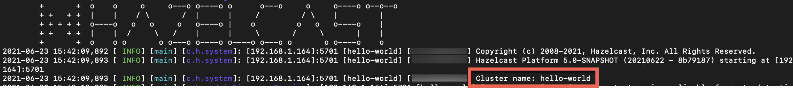
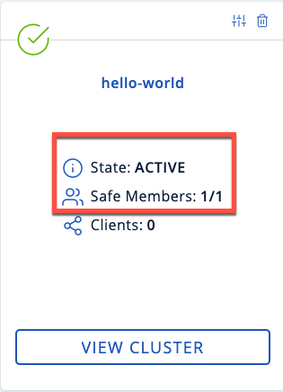
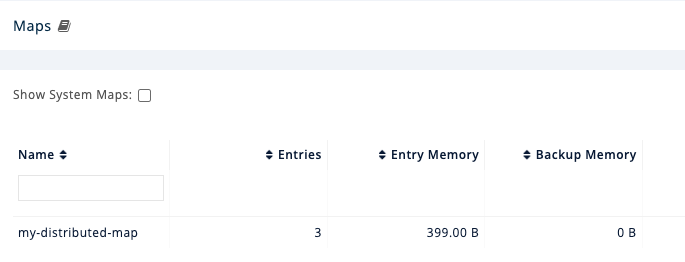
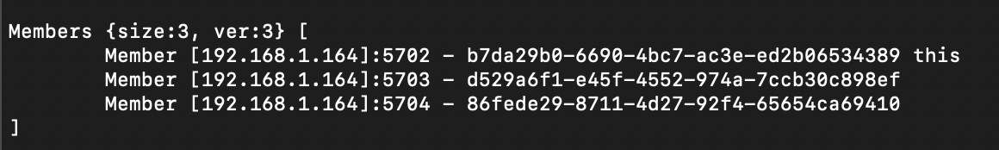
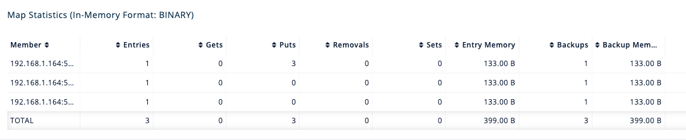

import PartialDeployDockerIpWarning from "@site/hazelcast_versioned_docs/version-6.1/_partials/deploy-docker-ip-warning.mdx";
import Tabs from "@theme/Tabs";
import TabItem from "@theme/TabItem";

This tutorial introduces you to Hazelcast in a client/server topology. At the end of this tutorial, you'll know how to start a cluster in a single Docker host, store data in memory, visualize your data and more.

:::note

Although running multiple members on a single Docker host is useful for testing, it's not suitable for production. To run a physically distributed cluster in containers, see [Deploy on Docker](../../install-and-upgrade/overview/deploying-with-docker.mdx) or [Deploying on Kubernetes](../../develop-and-build/kubernetes/deploying-in-kubernetes.mdx).

:::

## Step 1: Pull the Hazelcast Docker image

1. [Install Docker](https://docs.docker.com/get-docker/).
2. Check that Docker is correctly installed.

   ```bash
   docker version
   ```

   If you do not see a version number, see the [Docker documentation](https://docs.docker.com/config/daemon/) for troubleshooting information.
3. Pull the Hazelcast Docker image:

   ```shell vars
   docker pull hazelcast/hazelcast:{os-version}
   ```

## Step 2: Start a local member

Hazelcast clusters consist of servers called *members*. These members communicate with each other to form a distributed network. It's these members that store and process your data in memory.

In this step, you use the Hazelcast Docker image to start a local single-member cluster called `hello-world`.

1. Create a new Docker network called `hazelcast-network`.

   ```shell
   docker network create hazelcast-network
   ```

   Docker networks make it easier for you to connect to your cluster and add other services that need to communicate with your cluster.
2. To start a member, execute the Docker `run` command.

   <PartialDeployDockerIpWarning />

   Replace the `<host_ip>` placeholder with the IP address of your Docker host.

   ```shell vars
   docker run \
       -it \
       --network hazelcast-network \
       --rm \
       -e HZ_NETWORK_PUBLICADDRESS=<host_ip>:5701 \
       -e HZ_CLUSTERNAME=hello-world \
       -p 5701:5701 hazelcast/hazelcast:{os-version}
   ```

   Hazelcast environment variables:

   - `HZ_NETWORK_PUBLICADDRESS`: The public IP address of your Docker host.
   - `HZ_CLUSTERNAME`: The name of your cluster.

     Docker parameters:
   - `-it`: Starts an interactive session, allowing you to stop the member with <kbd>Ctrl</kbd>+<kbd>C</kbd>.
   - `--rm`: Tells Docker to remove the container from its local cache after it exits.
   - `--network`: Allows you to connect to clusters, using an alias.
   - `-p`: Expose port 5701 to allow external clients to connect to the member's Docker container.

You should see your cluster name in the console along with the IP address of the Docker host:



## Step 3: Write data to memory

Hazelcast has lots of distributed data structures available for writing data to memory on your cluster. One of the most popular ways of writing data to memory is to use a distributed map. Maps store key/value pairs called entries, which are replicated and distributed across a cluster.

<Tabs groupId="c-43-43--c-sharp--go--java--nodejs--python--sql">
<TabItem value="sql" label="SQL">

1. In a new terminal window, start the SQL shell.

   Replace the `<host_ip>` placeholder with the IP address of your Docker host.

   ```shell vars
   docker run --network hazelcast-network -it --rm hazelcast/hazelcast:{os-version} hz-cli --targets hello-world@<host_ip> sql
   ```

   The `--targets` parameter tells the SQL shell to connect to the member at the given IP address in a cluster called `hello-world`.
2. Create a map and add data to it.

   ```sql
   CREATE MAPPING my_distributed_map TYPE IMap OPTIONS ('keyFormat'='varchar','valueFormat'='varchar');

   SINK INTO my_distributed_map VALUES
   ('1', 'John'),
   ('2', 'Mary'),
   ('3', 'Jane');
   ```
3. Exit the SQL shell.

   ```shell
   exit
   ```

</TabItem>
<TabItem value="java" label="Java">

1. [Install the Java client library](../../install-and-upgrade/community-edition/install-hazelcast.mdx#use-java)
2. Add the following to your file:

   ```java conums
   import com.hazelcast.client.HazelcastClient;
   import com.hazelcast.client.config.ClientConfig;
   import com.hazelcast.core.HazelcastInstance;
   import com.hazelcast.map.IMap;

   public class MapSample {
     public static void main(String[] args) {

       ClientConfig clientConfig = new ClientConfig();
       clientConfig.setClusterName("hello-world"); <1>

       HazelcastInstance client = HazelcastClient.newHazelcastClient(clientConfig); <2>
       IMap <String,String> map = client.getMap("my-distributed-map"); <3>

       <4>
       map.put("1", "John");
       map.put("2", "Mary");
       map.put("3", "Jane");
     }
   }
   ```

   <CodeCallouts>

   1. The name of the cluster that you want to connect to.
   2. Create a client instance, using your configuration.
   3. Create a map called `my-distributed-map`.
   4. Write some keys and values to the map.

   </CodeCallouts>

</TabItem>
<TabItem value="c-43-43" label="C++">

1. [Install the latest C++ client library](https://github.com/hazelcast/hazelcast-cpp-client/blob/v4.1.0/Reference_Manual.md#11-installing)
2. Add the following to your file:

   ```cpp conums
   #include <hazelcast/client/hazelcast_client.h>

   int main() {
     hazelcast::client::client_config config;
     config.set_cluster_name("hello-world"); <1>

     auto client = hazelcast::new_client(std::move(config)).get(); <2>

     auto map = client.get_map("my-distributed-map").get(); <3>

     <4>
     map->put<std::string, std::string>("1", "John").get();
     map->put<std::string, std::string>("2", "Mary").get();
     map->put<std::string, std::string>("3", "Jane").get();

     return 0;
   }
   ```

   <CodeCallouts>

   1. The name of the cluster that you want to connect to.
   2. Create a client instance, using your configuration.
   3. Create a map called `my-distributed-map`.
   4. Write some keys and values to the map.

   </CodeCallouts>

</TabItem>
<TabItem value="c-sharp" label="C Sharp">

1. [Install the latest C Sharp client library](http://hazelcast.github.io/hazelcast-csharp-client/4.0.1/doc/obtaining.html)
2. Add the following to your file:

   ```cs conums
   using Hazelcast.Client;

   namespace Hazelcast.Examples.Org.Website.Samples
   {
     public class MapSample
     {
       public static void Run(string[] args)
       {
         var options = new HazelcastOptionsBuilder().Build();
         options.ClusterName = "hello-world"; <1>

         var client = await HazelcastClientFactory.StartNewClientAsync(options); <2>

         var map = client.GetMap("my-distributed-map"); <3>

         <4>
         map.put("1", "John");
         map.put("2", "Mary");
         map.put("3", "Jane");
       }
     }
   }
   ```

   <CodeCallouts>

   1. The name of the cluster that you want to connect to.
   2. Create a client instance, using your configuration.
   3. Create a map called `my-distributed-map`.
   4. Write some keys and values to the map.

   </CodeCallouts>

</TabItem>
<TabItem value="nodejs" label="Node.js">

1. Install the Node.js client library.

   ```shell
   npm install hazelcast-client
   ```
2. Add the following to your file:

   ```javascript conums
   const { Client } = require('hazelcast-client');

   (async () => {
     try {
       const client = await Client.newHazelcastClient({
         clusterName: 'hello-world', <1>
       }); <2>

       const map = await client.getMap('my-distributed-map'); <3>

       <4>
       await map.put('1', 'John');
       await map.put('2', 'Mary');
       await map.put('3', 'Jane');

     } catch (error) {
       console.error('Error occurred:', error);
     }
   })();
   ```

   <CodeCallouts>

   1. The name of the cluster that you want to connect to.
   2. Create a client instance, using your configuration.
   3. Create a map called `my-distributed-map`.
   4. Write some keys and values to the map.

   </CodeCallouts>

</TabItem>
<TabItem value="python" label="Python">

1. Install the Python client library.

   ```shell
   pip install hazelcast-python-client
   ```
2. Add the following to your file:

   ```python conums
   import hazelcast

   if __name__ == "__main__":
     client = hazelcast.HazelcastClient(
     cluster_name="hello-world", <1>
     ) <2>

     # Create a Distributed Map in the cluster
     map = client.get_map("my-distributed-map").blocking() <3>

     <4>
     map.put("1", "John")
     map.put("2", "Mary")
     map.put("3", "Jane")
   ```

   <CodeCallouts>

   1. The name of the cluster that you want to connect to.
   2. Create a client instance, using your configuration.
   3. Create a map called `my-distributed-map`.
   4. Write some keys and values to the map.

   </CodeCallouts>

</TabItem>
<TabItem value="go" label="Go">

1. Install the Go client library.

   ```shell
   go get github.com/hazelcast/hazelcast-go-client
   ```
2. Add the following to your file:

   ```go conums
   package main

   import (
     "context"
     "fmt"
     "log"

     "github.com/hazelcast/hazelcast-go-client"
   )

   func main() {
     ctx := context.TODO()

     cfg := hazelcast.Config{}
     cfg.Cluster.Name = "hello-world" <1>

     hz, err := hazelcast.StartNewClientWithConfig(ctx, cfg) <2>
     if err != nil {
       panic(fmt.Errorf("starting the client with config: %w", err))
     }

     mp, err := hz.GetMap(ctx, "my-distributed-map") <3>
     if err != nil {
       panic(fmt.Errorf("trying to get a map: %w", err))
     }

     <4>
     _, err = mp.Put(ctx, 1, "John")
     if err != nil {
       panic(fmt.Errorf("trying to put to map: %w", err))
     }

     _, err = mp.Put(ctx, 2, "Mary")
     if err != nil {
       panic(fmt.Errorf("trying to put to map: %w", err))
     }

     _, err = mp.Put(ctx, 3, "Jane")
     if err != nil {
       panic(fmt.Errorf("trying to put to map: %w", err))
     }
   }
   ```

   <CodeCallouts>

   1. The name of the cluster that you want to connect to.
   2. Create a client instance, using your configuration.
   3. Create a map called `my-distributed-map`.
   4. Write some keys and values to the map.

   </CodeCallouts>

</TabItem>
</Tabs>

## Step 4: Read data from memory

You can read the data that you just wrote to memory by connecting to the member with a different client and requesting data from the member.

<Tabs groupId="c-43-43--c-sharp--go--java--nodejs--python--sql">
<TabItem value="sql" label="SQL">

1. In a new terminal window, start the SQL shell.

   Replace the `<host_ip>` placeholder with the IP address of your Docker host.

   ```shell vars
   docker run --network hazelcast-network -it --rm hazelcast/hazelcast:{os-version} hz-cli --targets hello-world@<host_ip> sql
   ```
2. Query all data in the map.

   ```sql
   SELECT * FROM my_distributed_map;
   ```

   ```none
   +--------------------+--------------------+
   |__key               |this                |
   +--------------------+--------------------+
   |3                   |Jane                |
   |1                   |John                |
   |2                   |Mary                |
   +--------------------+--------------------+
   ```
3. Exit the SQL shell.

   ```shell
   exit
   ```

</TabItem>
<TabItem value="java" label="Java">

```java conums
import com.hazelcast.client.HazelcastClient;
import com.hazelcast.client.config.ClientConfig;
import com.hazelcast.core.HazelcastInstance;
import com.hazelcast.map.IMap;

public class MapSample {
  public static void main(String[] args) {

    ClientConfig clientConfig = new ClientConfig();
    clientConfig.setClusterName("hello-world");

    HazelcastInstance client = HazelcastClient.newHazelcastClient(clientConfig);

    <1>
    IMap <String,String> map = client.getMap("my-distributed-map");
    for (Map.Entry<String, String> entry : map.entrySet()) {
      System.out.println(entry.getKey() + " " + entry.getValue());
    }

    client.shutdown(); <2>
  }
}
```

<CodeCallouts>

1. Request all data in the map and print it to the console.
2. Disconnect from the member.

</CodeCallouts>

</TabItem>
<TabItem value="c-43-43" label="C++">

```cpp conums
#include <hazelcast/client/hazelcast_client.h>

int main() {
  hazelcast::client::client_config config;
  config.set_cluster_name("hello-world");

  auto client = hazelcast::new_client(std::move(config)).get();

  auto map = client.get_map("my-distributed-map").get();

  <1>
  auto map = client.get_map("my-distributed-map").get();
  auto entries = map->entry_set<std::string, std::string>().get();
  for (auto &entry : map->entry_set<std::string, std::string>().get()) {
    std::cout << entry.first << " " << entry.second << std::endl;
  }

  client.shutdown(); <2>

  return 0;
}
```

<CodeCallouts>

1. Request all data in the map and print it to the console.
2. Disconnect from the member.

</CodeCallouts>

</TabItem>
<TabItem value="c-sharp" label="C Sharp">

```cs conums
using Hazelcast.Client;
using System;
using System.Threading.Tasks;

namespace Hazelcast.Examples.Org.Website.Samples
{
  public class MapSample
  {
    public static async Task Main(string[] args)
    {
      var options = new HazelcastOptionsBuilder().Build();
      options.ClusterName = "hello-world";

      await using var client = await HazelcastClientFactory.StartNewClientAsync(options);

      <1>
      var map = await client.GetMapAsync<string, string>("my-distributed-map");
      foreach (var entry in await map.GetEntriesAsync())
        Console.WriteLine($"{entry.Key}: {entry.Value}");

      client.Shutdown(); <2>
    }
  }
}
```

<CodeCallouts>

1. Request all data in the map and print it to the console.
2. Disconnect from the member.

</CodeCallouts>

</TabItem>
<TabItem value="nodejs" label="Node.js">

```javascript conums
const { Client } = require('hazelcast-client');

(async () => {
  try {
    const client = await Client.newHazelcastClient({
      clusterName: 'hello-world',
    });

    <1>
    const map = await client.getMap('my-distributed-map');
    for (const [key, value] of await map.entrySet()) {
        console.log(`${key} ${value}`);
    }

    await hz.shutdown(); <2>

  } catch (error) {
    console.error('Error occurred:', error);
  }
})();
```

<CodeCallouts>

1. Request all data in the map and print it to the console.
2. Disconnect from the member.

</CodeCallouts>

</TabItem>
<TabItem value="python" label="Python">

```python conums
import hazelcast

if __name__ == "__main__":
  client = hazelcast.HazelcastClient(
  cluster_name="hello-world",
  )

  <1>
  my_map = client.get_map("my-distributed-map").blocking()
  for key, value in my_map.entry_set():
    print(key, value)

  client.shutdown() <2>
```

<CodeCallouts>

1. Request all data in the map and print it to the console.
2. Disconnect from the member.

</CodeCallouts>

</TabItem>
<TabItem value="go" label="Go">

```go conums
package main

import (
  "context"
  "fmt"

  "github.com/hazelcast/hazelcast-go-client"
)

func main() {
  ctx := context.TODO()

  cfg := hazelcast.Config{}
  cfg.Cluster.Name = "hello-world"

  hz, err := hazelcast.StartNewClientWithConfig(ctx, cfg)
  if err != nil {
    panic(fmt.Errorf("starting the client with config: %w", err))
  }

  defer hz.Shutdown(ctx) <2>

  mp, err := hz.GetMap(ctx, "my-distributed-map") <1>
  if err != nil {
    panic(fmt.Errorf("trying to get a map: %w", err))
  }

  entries, err := mp.GetEntrySet(ctx)
  if err != nil {
    panic(fmt.Errorf("trying to get an entries of the map: %w", err))
  }

  for _, entry := range entries {
    fmt.Printf("key: %v, value: %v\n", entry.Key, entry.Value)
  }
}
```

<CodeCallouts>

1. Request all data in the map and print it to the console.
2. Disconnect from the member.

</CodeCallouts>

</TabItem>
</Tabs>

## Step 5: Set up Management Center

Management Center is a user interface for managing and monitoring your cluster.

In this step, you start a local instance of Management Center and use it to view your cluster's statistics.

1. Start Management Center.

   ```shell vars
   docker run \
       --network hazelcast-network \
       -p 8080:8080 hazelcast/management-center:{page-latest-supported-mc-installer}
   ```
2. In a web browser, go to localhost:8080 and enable dev mode.

   
3. Enter your cluster's name and IP address.

   You should see that you cluster is in an active state and has a single member. An active cluster is one that is operating without restrictions. To learn more about cluster states, see [Cluster States](../../operate-and-manage/maintaining-a-cluster/cluster-utilities.mdx#cluster-states).

   
4. Click **View Cluster** and go to **Clients**.

   You should see that two clients are connected to your cluster member: Management Center and the Hazelcast client that you used to write data to a map.
5. Go to **Storage** \> **Maps**.

   You should see that your cluster has a map called `my-distributed-map` with three entries (keys and values). You'll also see the total amount of memory that those entries are taking up in your cluster.

   

   For now, the backup memory is 0 because you don't have any other members in your cluster on which to back up your map entries.

To back up your map, you need to scale up your cluster.

## Step 6. Scale your Cluster

If your cluster starts to run out of memory, you can add more members to it and they will distribute their data across the new members.

Your cluster will even create a copy of any map entries and distribute them across other members of the cluster. This way, your data is secure in case of a single member failure.

In this step, you add two more members to your cluster.

1. Open a new terminal and execute the Docker `run` command again to start another member.

   Replace the `<host_ip>` placeholder with the IP address of your Docker host.

   :::note

   Each container must expose port 5701 from a different port on the host machine. On this member, port 5701 is exposed to port 5702 on the host machine.

   :::

   ```shell vars
   docker run \
       --name my-second-member --network hazelcast-network \
       -e HZ_NETWORK_PUBLICADDRESS=<host_ip>:5702 \
       -e HZ_CLUSTERNAME=hello-world \
       -p 5702:5701 hazelcast/hazelcast:{os-version}
   ```
2. Start another member.

   Replace the `<host_ip>` placeholder with the IP address of your Docker host.

   ```shell vars
   docker run \
       --name my-third-member --network hazelcast-network \
       -e HZ_NETWORK_PUBLICADDRESS=<host_ip>:5703 \
       -e HZ_CLUSTERNAME=hello-world \
       -p 5703:5701 hazelcast/hazelcast:{os-version}
   ```

   You should see that your members find and connect to each other automatically to form your `hello-world` cluster. You can learn more about how members do this in [Discovery Mechanisms](../../develop-and-build/member-and-client-discovery/discovery-mechanisms.mdx).

   

   :::note

   Running more than one member on a single host is useful for testing Hazelcast, but it's not suitable for production.

   :::
3. Back in Management Center, go to **Storage** \> **Maps** again.

   You should see that the backup memory is the same as the entry memory, meaning that all your map entries have now been copied and distributed among the other two cluster members.
4. To see how your map entries are distributed among members in your cluster, click **my-distributed-map**.

   

   You should see that entries and their backups are distributed evenly across each member. This process is called partitioning. You can learn more about this subject in [Data Partitioning and Replication](../../develop-and-build/architecture/data-partitioning.mdx).

## Step 7: Simulate a member failure

If a member fails for any reason, the other cluster members use their backups to repartition the data across the remaining cluster members.

In the terminal of one of your running members, press <kbd>Ctrl</kbd>+<kbd>C</kbd> to shut down the member.

You should the `Hazelcast Shutdown is completed` message in the console.

In Management Center, you should also see that the amount of entry memory and backup memory has not changed. All your map entries are still in memory despite a member being shut down. The remaining Hazelcast members have repartitioned the data.

## Next steps

Now that you have a local cluster, you can continue your journey with the following tutorials:

- [Get started with SQL](../get-started-with-sql/get-started-sql.mdx) by learning how to query data in your cluster.
- [Get started with Data Processing](../../develop-and-build/building-data-pipelines/get-started/stream-processing-client.mdx) by learning how to use the Java Jet API.

If you just want to go straight into deploying a production-ready cluster, see [Best practices](../../develop-and-build/best-practices/overview.mdx).

Explore the tools Hazelcast offers for the following use cases:

- [Caching data](../../develop-and-build/distributed-data-structures/overview.mdx)
- [Distributed computing](../../develop-and-build/distributed-computing/overview.mdx)
- [Distributed queries](../../develop-and-build/data-ingestion-and-query/overview-query.mdx)
- [Ingesting data](../../develop-and-build/data-ingestion-and-query/overview.mdx)

If you're interested in learning more about topics introduced in this tutorial, see the following resources:

- [Deploy on Docker](../../install-and-upgrade/overview/deploying-with-docker.mdx).
- [Cluster states](../../operate-and-manage/maintaining-a-cluster/cluster-member-states.mdx)
- [Clients](../hazelcast-clients/overview.mdx)
- [Data partitioning](../../develop-and-build/architecture/data-partitioning.mdx)
- [Maps and other data structures](../../develop-and-build/distributed-data-structures/distributed-data-structures.mdx)
- <Variable href="/management-center/{page-latest-supported-mc}/getting-started/overview" text="Management Center" />
- [Network partitioning](../../operate-and-manage/fault-tolerance/handling-network-partitions/network-partitioning.mdx)
