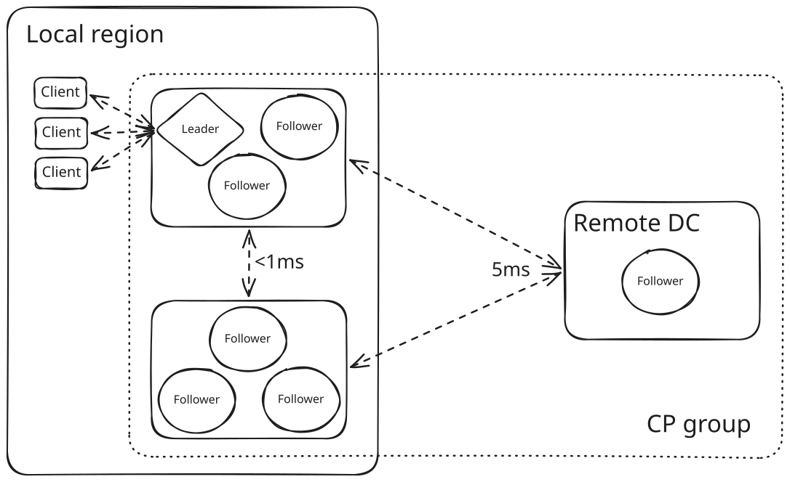

import Tabs from "@theme/Tabs";
import TabItem from "@theme/TabItem";
import PartialRequiresEnterprise from "@site/hazelcast_versioned_docs/version-6.1/_partials/requires-enterprise.mdx";
import PartialRequiresAdvancedCp from "@site/hazelcast_versioned_docs/version-6.1/_partials/requires-advanced-cp.mdx";

You can configure clusters to enable the CP Subsystem and adjust other options such as CP groups sizes and persistence of CP state.

## Quickstart

Use this quickstart to enable the CP Subsystem for development and testing. The CP Subsystem is disabled by default; you must configure CP members before you can create or use [CP data structures](./cp-subsystem.mdx#cp-data-structures).

:::note

Running clusters must be [restarted](../maintaining-a-cluster/restart-cluster.mdx) before any configuration changes take effect.

:::

1. To enable the CP Subsystem, configure a non-zero value for the [`cp-member-count`](#cp-member-count) option:

   <Tabs groupId="config-format">
   <TabItem value="xml" label="XML">

   ```xml
   <hazelcast>
     <cp-subsystem>
       <cp-member-count>3</cp-member-count>
       <!-- configuration options here -->
     </cp-subsystem>
   </hazelcast>
   ```

   </TabItem>
   <TabItem value="yaml" label="YAML">

   ```yaml
   hazelcast:
     cp-subsystem:
       cp-member-count: 3
       # configuration options here
   ```

   </TabItem>
   <TabItem value="java" label="Java">

   Use the <Variable href="https://docs.hazelcast.org/docs/{os-version}/javadoc/com/hazelcast/config/cp/CPSubsystemConfig.html" text="CPSubsystemConfig" code /> object.

   ```java
   Config config = new Config();

   config.getCPSubsystemConfig()
   .setCPMemberCount(3)
   ```

   </TabItem>
   </Tabs>
2. [Restart the cluster](../maintaining-a-cluster/restart-cluster.mdx).

## Persist CP data structures {/* #persistence */}

<PartialRequiresEnterprise />

To enable [CP Subsystem persistence](./cp-subsystem.mdx#persistence), set the [`persistence-enabled`](#persistence-enabled) option to `true`.

When CP Subsystem persistence is enabled, all Hazelcast cluster members — including AP members — create a directory under the base `cp-data` directory. CP members persist CP state in these sub-directories. AP members persist only their status as non-CP members. Ensure that you do not delete these directories unless you need to remove stale data to recover the system as described in [CP Subsystem persistence and AP persistence](#ap-cp).

To change the base directory, set a value in the [`base-dir`](#base-dir) option.

### CP Subsystem persistence and AP persistence {/* #ap-cp */}

Hazelcast also offers [persistence](../fault-tolerance/persistence/persistence.mdx) for some AP data structures. If you persist AP and CP data structures in a single Hazelcast cluster, be aware that member or cluster restarts can fail if the persisted data (CP or AP) becomes stale.

You can configure AP members to automatically remove stale data with the `auto-remove-stale-data` option — see [Configuring persistence](../fault-tolerance/persistence/configuring-persistence.mdx). Otherwise, you will need to remove stale data manually.

CP members can usually rejoin the cluster after a restart. The CP group leader will reissue any missing operations to catch up the rejoining member's Raft log. However, if a CP member gets significantly out of sync, you may need to remove stale data manually.

## Choose a group size

For all [CP groups](./cp-subsystem.mdx#cp-groups), you can set the number of CP members that should participate in each one using the [`group-size`](#group-size) option.

To scale out throughput and memory capacity, you can choose a CP group size that is smaller than the [CP member count](#cp-member-count) to distribute your CP data structures to multiple CP groups.

:::note

If you want to distribute CP data to a group other than `DEFAULT`, you must specify the group name when creating or fetching the CP data structure proxy.

:::

CP groups must consist of three, five, or seven members. An odd number of CP members avoids stalemate scenarios in leadership elections and quorum calculations.

For a CP group of `N` members:

- the majority of members is calculated as `(N + 1) / 2`.
- the number of failing members the group can tolerate is calculated as `(N - 1) / 2`.

For example, in a CP group of five CP members, operations are committed when they are replicated to at least three CP members. This CP group can tolerate the failure of two CP members and remain available.

Creating separate CP groups allows clients to distribute the load among the leaders of several CP groups. However, a large number of CP groups running on the same members may slow down the system. A good compromise is to create the same number of CP groups as CP members for high throughput use cases. That way, each member will usually be the leader of one group.

You should [destroy](./management.mdx#destroying-a-cp-group-by-force) any unused CP groups.

## Configure leadership priority {/* #configuring-leadership-priority */}

Some CP members are better leadership candidates than others. For example, members in your local data center are better candidates because of the reduced latency to clients, and members under high load are poor candidates because they are more likely to suffer from downtime. To maximise the availability and throughput of the CP subsystem, you can configure CP members with a priority rating, using the [`cp-member-priority`](#cp-member-priority) option.

On startup, any CP member with any priority can become a leader and `cp-member-priority` has no effect. The background leadership rebalancing task periodically transfers the leadership from CP members with the lowest priorities to those with higher priorities within each CP group. Eventually, all CP group leaders are CP members with high priorities.

Only CP members that are part of a CP group can become leaders. CP members that are not in a CP group do not participate in the leadership rebalancing task. For example, you start a cluster with the CP group size set to three and all members with priority 0. Later, you configure a new CP member with priority 100. Even though it has a higher priority, the new CP member never becomes a leader because the CP group is full. The new CP member is eligible for leadership only when a CP member leaves the CP group and the new CP member takes the previous member's place.

:::important

[`cp-member-priority`](#cp-member-priority) does not override the Raft leadership election process: it is a hint rather than a rule. Consequently, it is possible that a member with a low priority becomes leader for a period until the background leadership rebalancing task transfers the leadership to a member with a higher priority. The leadership rebalancing task runs approximately every 60 seconds; however, a custom frequency can be defined by the system property `hazelcast.raft.leadership.rebalance.period`. If necessary, you can also [configure members to transfer leadership](#autostepdown) to another member if elected.

:::

## Configure members to automatically step down from leadership {/* #autostepdown */}

<PartialRequiresAdvancedCp />

In some deployment scenarios, you may want to prevent a CP group member from becoming the leader. For example, if your CP group is distributed across two local data centers and one remote data center for geographic redundancy, there may be a higher latency to the remote data center. The following diagram shows an example deployment distributed across three data centers.



If the CP group leader is in one of the local data centers — and there are enough local followers to achieve quorum — the leader will not need to wait for acknowledgements from follower(s) in the remote data center and so the increased latency will have no impact. If the leader is in the remote data center, there will be a higher latency because each quorum calculation will be limited by the slowest roundtrip time, reducing throughput. There will also be an increased risk of instability and election timeouts due to longer snapshot transfer windows from the leader, and there may be higher latency between clients and the remote data center.

To avoid this scenario, you can enable [`auto-step-down-when-leader`](#auto-step-down-when-leader) to force CP members in the remote data center to automatically transfer leadership to another member. The increased latency will then only have an impact if a remote member is needed to achieve quorum.

:::important

Reducing the number of leadership candidates can improve stability in certain deployment scenarios, but it reduces availability. You should therefore only enable this feature if it is necessary to achieve your throughput requirements, and you should enable it on as few members as possible (up to a maximum of `(N - 1) / 2`).

:::

In the Raft algorithm election process, a member **must** become leader if it has the most up-to-date log in the group ([In Search of an Understandable Consensus Algorithm](https://raft.github.io/raft.pdf) section 5.4.1, *Election restriction*). It is possible that the only available candidate is a member with `auto-step-down-when-leader` enabled. In this case, the `auto-step-down` member will become leader to safely transfer its up-to-date log to another member. The `auto-step-down` member rejects client operations, but they are retried internally and should succeed once the new leader is elected.

If two members are equally up-to-date, they are equally viable leadership candidates in an election. To help avoid `auto-step-down` members becoming leader in this scenario, a voter can reject a pre-vote request from an `auto-step-down` candidate when the log term and log index are the same as its own. This biases elections towards members that do not have `auto-step-down` configured.

:::tip

You can observe leadership transitions by searching for `LEADER (TRANSFERRING_LEADERSHIP)` in the logs. See [Configuring Logging](../logging.mdx).

:::

This feature does not apply to the `METADATA` group, which is not sensitive to latency.

## Configure CP sessions {/* #sessions */}

[Sessions](./cp-subsystem.mdx#sessions) offer a trade-off between liveness and safety. If you set a small value for the [`session-time-to-live-seconds`](#session-time-to-live-seconds) option, a session owner could be considered crashed very quickly and its resources could be released prematurely. On the other hand, if you set a large value, a session could be kept alive for an unnecessarily long duration after its owner crashes. We recommend using the default `session-time-to-live-seconds` duration. If a session owner is known to have crashed, you can close its session manually by calling this method on the handler side: `CPSessionManagementService#forceCloseSession(String, Long)`.

## Configure fenced locks {/* #fencedlock-configuration */}

By default, fenced locks are reentrant. This means that once a caller has acquired the lock, the same caller can acquire it again multiple times in a linearizable manner without releasing it first.

You can configure the reentrancy behavior with the [`lock-acquire-limit`](#lock-acquire-limit) option. For example, reentrancy can be disabled by setting this option to `1`, making the lock a non-reentrant mutex. You can also set a custom reentrancy limit. When the reentrancy limit is reached, the fenced lock fails with <Variable href="https://docs.hazelcast.org/docs/{os-version}/javadoc/com/hazelcast/cp/lock/exception/LockAcquireLimitReachedException.html" text="LockAcquireLimitReachedException" /> or a specified return value.

## Configure semaphores

By default, a caller must acquire permits before releasing them and it cannot release a permit that it has not acquired. This means that you can acquire a permit from one thread and release it from another thread, using the same caller, but not different callers. In this mode, acquired permits are automatically released upon failure of the caller.

To enable a permit to be released without acquiring it first, enable JDK compatibility by setting the `jdk-compatibility` option to `true`.

:::warning

When `jdk-compatibility` is set to `true`, Hazelcast does not auto-cleanup acquired permits upon caller failures. If a permit holder fails, its permits must be <Variable href="https://docs.hazelcast.org/docs/{os-version}/javadoc/com/hazelcast/cp/ISemaphore.html#release(int)" text="released manually" />.

:::

## Remove missing CP members {/* #remove */}

If CP Subsystem persistence is disabled, CP members lose their state after shutting down and so cannot rejoin the CP Subsystem. You can configure CP members to be automatically removed from the CP Subsystem after they shut down as well as how long to wait after they shut down before removing them.

By default, missing CP members are automatically removed from the CP Subsystem after four hours and are replaced by other CP members if any are available. You can configure this time using the [`missing-cp-member-auto-removal-seconds`](#missing-cp-member-auto-removal-seconds) option.

If a missing CP member rejoins the cluster after it is automatically removed from the CP Subsystem, that CP member must be terminated manually. See [Shutting Down a Hazelcast Member](../maintaining-a-cluster/shutdown.mdx#shutting-down-a-hazelcast-member).

If no CP members are available to replace a missing CP member, the group size of any groups that it was in is reduced and the majority values are recalculated. The CP group will continue to function as long as a majority of the configured number of CP members remains available.

When CP Subsystem persistence is enabled, CP members are not automatically removed from the CP Subsystem. These CP members can restore their CP state from disk and rejoin their CP groups. It is your responsibility to [remove CP members](./management.mdx#remove-a-cp-member) if they do not restart.

## Handle indeterminate operation state {/* #IndeterminateOperationStateException */}

When you invoke an API method on a CP data structure, the method replicates an internal operation to the corresponding CP group. After the CP leader commits this operation to the majority of the CP group, it sends a response to the public API call. If a failure causes loss of the response, then the caller cannot determine if the operation is committed on the CP group or not.

You can handle loss of the response in two ways:

- To allow CP leaders to replicate the operation to the CP group multiple times, set the [`fail-on-indeterminate-operation-state`](#fail-on-indeterminate-operation-state) option to `false` (default).
- To send an `IndeterminateOperationStateException` back to the caller, set the `fail-on-indeterminate-operation-state` option to `true`.

## Global configuration options

Use these options to configure the CP Subsystem.

<table>
<colgroup>
<col style={{width:'20%'}} />
<col style={{width:'20%'}} />
<col style={{width:'20%'}} />
<col style={{width:'40%'}} />
</colgroup>
<thead>
<tr>
<th>Option</th>
<th>Description</th>
<th>Default</th>
<th>Example</th>
</tr>
</thead>
<tbody>
<tr>
<td><Anchor id="cp-member-count" />`cp-member-count`</td>
<td>Number of CP members to initialize the CP Subsystem. If set, must be greater than or equal to [`group-size`](#group-size).</td>
<td>`0 (CP Subsystem disabled)`</td>
<td>

<Tabs groupId="config-format">
<TabItem value="xml" label="XML">

```xml
<hazelcast>
  <cp-subsystem>
    <cp-member-count>7</cp-member-count>
  </cp-subsystem>
</hazelcast>
```

</TabItem>
<TabItem value="yaml" label="YAML">

```yaml
hazelcast:
  cp-subsystem:
    cp-member-count: 7
```

</TabItem>
<TabItem value="java" label="Java">

```java
Config config = new Config();

config.getCPSubsystemConfig()
.setCPMemberCount(7)
```

</TabItem>
</Tabs>

</td>
</tr>
<tr>
<td><Anchor id="group-size" />`group-size`</td>
<td>Number of CP members to participate in each CP group. If set, this value must conform to the following rules: - Must be `3`, `5` or `7`. - Must be smaller than or equal to [`cp-member-count`](#cp-member-count).</td>
<td>[`Same as cp-member-count`](#cp-member-count)</td>
<td>

<Tabs groupId="config-format">
<TabItem value="xml" label="XML">

```xml
<hazelcast>
  <cp-subsystem>
    <group-size>7</group-size>
  </cp-subsystem>
</hazelcast>
```

</TabItem>
<TabItem value="yaml" label="YAML">

```yaml
hazelcast:
  cp-subsystem:
    group-size: 7
```

</TabItem>
<TabItem value="java" label="Java">

```java
Config config = new Config();

config.getCPSubsystemConfig()
.setGroupSize(7)
```

</TabItem>
</Tabs>

</td>
</tr>
<tr>
<td><Anchor id="session-time-to-live-seconds" />`session-time-to-live-seconds`</td>
<td>

Duration for a [CP session](#sessions) to be kept alive after the last received heartbeat. A CP session is closed if no session heartbeat is received during this duration.

Must be greater than `session-heartbeat-interval-seconds`, and smaller than or equal to `missing-cp-member-auto-removal-seconds`.

</td>
<td>`60`</td>
<td>

<Tabs groupId="config-format">
<TabItem value="xml" label="XML">

```xml
<hazelcast>
  <cp-subsystem>
    <session-time-to-live-seconds>300</session-time-to-live-seconds>
  </cp-subsystem>
</hazelcast>
```

</TabItem>
<TabItem value="yaml" label="YAML">

```yaml
hazelcast:
  cp-subsystem:
    session-time-to-live-seconds: 300
```

</TabItem>
<TabItem value="java" label="Java">

```java
Config config = new Config();

config.getCPSubsystemConfig()
.setSessionTimeToLiveSeconds(300)
```

</TabItem>
</Tabs>

</td>
</tr>
<tr>
<td><Anchor id="session-heartbeat-interval-seconds" />`session-heartbeat-interval-seconds`</td>
<td>

Interval in seconds for the periodically committed [CP session heartbeats](./cp-subsystem.mdx#sessions).

Must be smaller than `session-time-to-live-seconds`.

</td>
<td>`5`</td>
<td>

<Tabs groupId="config-format">
<TabItem value="xml" label="XML">

```xml
<hazelcast>
  <cp-subsystem>
    <session-heartbeat-interval-seconds>5</session-heartbeat-interval-seconds>
  </cp-subsystem>
</hazelcast>
```

</TabItem>
<TabItem value="yaml" label="YAML">

```yaml
hazelcast:
  cp-subsystem:
    session-heartbeat-interval-seconds: 5
```

</TabItem>
<TabItem value="java" label="Java">

```java
Config config = new Config();

config.getCPSubsystemConfig()
.setSessionHeartbeatIntervalSeconds(5)
```

</TabItem>
</Tabs>

</td>
</tr>
<tr>
<td><Anchor id="missing-cp-member-auto-removal-seconds" />`missing-cp-member-auto-removal-seconds`</td>
<td>

Duration in seconds to wait before automatically removing a missing CP member from the CP Subsystem.

Must be greater than or equal to [`session-time-to-live-seconds`](#session-time-to-live-seconds).

A value of `0` means the time is unlimited, so CP members are never automatically removed.

:::note

This option does not apply when CP Subsystem persistence is enabled. See [Remove missing CP members](#remove).

:::

</td>
<td>`14400 seconds (4 hours)`</td>
<td>

<Tabs groupId="config-format">
<TabItem value="xml" label="XML">

```xml
<hazelcast>
  <cp-subsystem>
    <missing-cp-member-auto-removal-seconds>14400
    </missing-cp-member-auto-removal-seconds>
  </cp-subsystem>
</hazelcast>
```

</TabItem>
<TabItem value="yaml" label="YAML">

```yaml
hazelcast:
  cp-subsystem:
    missing-cp-member-auto-removal-seconds: 14400
```

</TabItem>
<TabItem value="java" label="Java">

```java
Config config = new Config();

config.getCPSubsystemConfig()
.setMissingCpMemberAutoRemovalSeconds(14400)
```

</TabItem>
</Tabs>

</td>
</tr>
<tr>
<td><Anchor id="fail-on-indeterminate-operation-state" />`fail-on-indeterminate-operation-state`</td>
<td>Whether CP Subsystem operations use at-least-once and at-most-once execution guarantees. By default, operations use an at-least-once execution guarantee. If set to `true`, operations use an at-most-once execution guarantee. See [Handle indeterminate operation state](#IndeterminateOperationStateException)</td>
<td>`false`</td>
<td>

<Tabs groupId="config-format">
<TabItem value="xml" label="XML">

```xml
<hazelcast>
  <cp-subsystem>
    <fail-on-indeterminate-operation-state>false
    </fail-on-indeterminate-operation-state>
  </cp-subsystem>
</hazelcast>
```

</TabItem>
<TabItem value="yaml" label="YAML">

```yaml
hazelcast:
  cp-subsystem:
    fail-on-indeterminate-operation-state: false
```

</TabItem>
<TabItem value="java" label="Java">

```java
Config config = new Config();

config.getCPSubsystemConfig()
.setFailOnIndeterminateOperationState(false)
```

</TabItem>
</Tabs>

</td>
</tr>
<tr>
<td><Anchor id="persistence-enabled" />`persistence-enabled`</td>
<td>Whether [CP Subsystem persistence](#persistence) is globally enabled for CP groups created in the CP Subsystem. If enabled, CP members persist their local CP data to stable storage and can recover from crashes.</td>
<td>`false`</td>
<td>

<Tabs groupId="config-format">
<TabItem value="xml" label="XML">

```xml
<hazelcast>
  <cp-subsystem>
    <persistence-enabled>false
    </persistence-enabled>
  </cp-subsystem>
</hazelcast>
```

</TabItem>
<TabItem value="yaml" label="YAML">

```yaml
hazelcast:
  cp-subsystem:
    persistence-enabled: false
```

</TabItem>
<TabItem value="java" label="Java">

```java
Config config = new Config();

config.getCPSubsystemConfig()
.setPersistenceEnabled(false)
```

</TabItem>
</Tabs>

</td>
</tr>
<tr>
<td><Anchor id="base-dir" />`base-dir`</td>
<td>

Parent directory where persisted CP data is stored. This directory is created automatically if it does not exist.

This directory is shared among multiple CP members safely. This is especially useful for cloud environments where CP members generally use a shared filesystem.

</td>
<td>`cp-data`</td>
<td>

<Tabs groupId="config-format">
<TabItem value="xml" label="XML">

```xml
<hazelcast>
  <cp-subsystem>
    <base-dir>cp-data
    </base-dir>
  </cp-subsystem>
</hazelcast>
```

</TabItem>
<TabItem value="yaml" label="YAML">

```yaml
hazelcast:
  cp-subsystem:
    base-dir: cp-data
```

</TabItem>
<TabItem value="java" label="Java">

```java
Config config = new Config();

config.getCPSubsystemConfig()
.setBaseDir("/cp-data")
```

</TabItem>
</Tabs>

</td>
</tr>
<tr>
<td><Anchor id="data-load-timeout-seconds" />`data-load-timeout-seconds`</td>
<td>Timeout duration in seconds for CP members to restore their persisted data from disk. A CP member fails its startup if it cannot complete its CP data restore process in the configured duration.</td>
<td>`120`</td>
<td>

<Tabs groupId="config-format">
<TabItem value="xml" label="XML">

```xml
<hazelcast>
  <cp-subsystem>
    <data-load-timeout-seconds>120
    </data-load-timeout-seconds>
  </cp-subsystem>
</hazelcast>
```

</TabItem>
<TabItem value="yaml" label="YAML">

```yaml
hazelcast:
  cp-subsystem:
    data-load-timeout-seconds: 120
```

</TabItem>
<TabItem value="java" label="Java">

```java
Config config = new Config();

config.getCPSubsystemConfig()
.setDataLoadTimeoutSeconds(120)
```

</TabItem>
</Tabs>

</td>
</tr>
</tbody>
</table>

## Fenced lock options {/* #fenced-lock-config */}

Use the following options to configure fenced locks:

<Tabs groupId="config-format">
<TabItem value="xml" label="XML">

```xml
<hazelcast>
  <cp-subsystem>
    <locks>
      <fenced-lock>
        <!-- insert configuration options here -->
      </fenced-lock>
    </locks>
  </cp-subsystem>
</hazelcast>
```

</TabItem>
<TabItem value="yaml" label="YAML">

```yaml
hazelcast:
  cp-subsystem:
    locks:
      # insert configuration options here
```

</TabItem>
<TabItem value="java" label="Java">

Add configuration options to the <Variable href="https://docs.hazelcast.org/docs/{os-version}/javadoc/com/hazelcast/config/cp/FencedLockConfig.html" text="FencedLockConfig object" />.

```java
Config config = new Config();

FencedLockConfig lockConfig = new FencedLockConfig(/*options*/);

config.getCPSubsystemConfig().addLockConfig(lockConfig);
```

</TabItem>
</Tabs>

<table>
<colgroup>
<col style={{width:'20%'}} />
<col style={{width:'20%'}} />
<col style={{width:'20%'}} />
<col style={{width:'40%'}} />
</colgroup>
<thead>
<tr>
<th>Option</th>
<th>Description</th>
<th>Default</th>
<th>Example</th>
</tr>
</thead>
<tbody>
<tr>
<td><Anchor id="name" />`name`</td>
<td>The name of the fenced lock to configure.</td>
<td>`' ' (empty)`</td>
<td>

<Tabs groupId="config-format">
<TabItem value="xml" label="XML">

```xml
<hazelcast>
  <cp-subsystem>
    <locks>
      <fenced-lock>
        <name>lock1</name>
      </fenced-lock>
    </locks>
  </cp-subsystem>
</hazelcast>
```

</TabItem>
<TabItem value="yaml" label="YAML">

```yaml
hazelcast:
  cp-subsystem:
    locks:
      lock1:
```

</TabItem>
<TabItem value="java" label="Java">

```java
Config config = new Config();

FencedLockConfig lockConfig = new FencedLockConfig(lock1, /*acquire limit*/);

config.getCPSubsystemConfig().addLockConfig(lockConfig);
```

</TabItem>
</Tabs>

</td>
</tr>
<tr>
<td><Anchor id="lock-acquire-limit" />`lock-acquire-limit`</td>
<td>Maximum number of reentrant lock acquisitions. Once a caller acquires the lock this many times, it will not be able to acquire the lock again, until it makes at least one `unlock()` call. If lock-acquire-limit is set to `1`, then the lock becomes non-reentrant.</td>
<td>`0 (no limit)`</td>
<td>

<Tabs groupId="config-format">
<TabItem value="xml" label="XML">

```xml
<hazelcast>
  <cp-subsystem>
    <locks>
      <fenced-lock>
        <name>lock1</name>
        <acquire-limit>1</acquire-limit>
      </fenced-lock>
    </locks>
  </cp-subsystem>
</hazelcast>
```

</TabItem>
<TabItem value="yaml" label="YAML">

```yaml
hazelcast:
  cp-subsystem:
    locks:
      lock1:
        lock-acquire-limit: 1
```

</TabItem>
<TabItem value="java" label="Java">

```java
Config config = new Config();

FencedLockConfig lockConfig = new FencedLockConfig(lock1, 1);

config.getCPSubsystemConfig().addLockConfig(lockConfig);
```

</TabItem>
</Tabs>

</td>
</tr>
</tbody>
</table>

## Semaphore options {/* #semaphore-config */}

Use the following options to configure semaphores:

<Tabs groupId="config-format">
<TabItem value="xml" label="XML">

```xml
<hazelcast>
  <cp-subsystem>
    < semaphores >
      <semaphore>
        <!-- insert configuration options here -->
      </semaphore >
    </semaphores >
  </cp-subsystem>
</hazelcast>
```

</TabItem>
<TabItem value="yaml" label="YAML">

```yaml
hazelcast:
  cp-subsystem:
    semaphores:
      # insert configuration options here
```

</TabItem>
<TabItem value="java" label="Java">

Add configuration options to the <Variable href="https://docs.hazelcast.org/docs/{os-version}/javadoc/com/hazelcast/config/cp/SemaphoreConfig.html" text="SemaphoreConfig object" />.

```java
Config config = new Config();

SemaphoreConfig semaphoreConfig = new SemaphoreConfig(/*insert configuration options here*/);

config.getCPSubsystemConfig().addSemaphoreConfig(semaphoreConfig);
```

</TabItem>
</Tabs>

<table>
<colgroup>
<col style={{width:'20%'}} />
<col style={{width:'20%'}} />
<col style={{width:'20%'}} />
<col style={{width:'40%'}} />
</colgroup>
<thead>
<tr>
<th>Option</th>
<th>Description</th>
<th>Default</th>
<th>Example</th>
</tr>
</thead>
<tbody>
<tr>
<td><Anchor id="semaphore-name" />`name`</td>
<td>Name of the semaphore.</td>
<td>`' ' (empty)`</td>
<td>

<Tabs groupId="config-format">
<TabItem value="xml" label="XML">

```xml
<hazelcast>
  <cp-subsystem>
    <semaphores>
      <semaphore>
          <name>sem1</name>
      </semaphore>
    </semaphores>
  </cp-subsystem>
</hazelcast>
```

</TabItem>
<TabItem value="yaml" label="YAML">

```yaml
hazelcast:
  cp-subsystem:
    semaphores:
      sem1:
```

</TabItem>
<TabItem value="java" label="Java">

```java
Config config = new Config();

SemaphoreConfig semaphoreConfig = new SemaphoreConfig("sem1");

config.getCPSubsystemConfig().addSemaphoreConfig(semaphoreConfig);
```

</TabItem>
</Tabs>

</td>
</tr>
<tr>
<td><Anchor id="jdk-compatible" />`jdk-compatible`</td>
<td>Whether JDK compatibility is enabled. See [Semaphores](#semaphores).</td>
<td>`false`</td>
<td>

<Tabs groupId="config-format">
<TabItem value="xml" label="XML">

```xml
<hazelcast>
  <cp-subsystem>
    <semaphores>
      <semaphore>
          <name>sem1</name>
          <jdk-compatible>false</jdk-compatible>
      </semaphore>
    </semaphores>
  </cp-subsystem>
</hazelcast>
```

</TabItem>
<TabItem value="yaml" label="YAML">

```yaml
hazelcast:
  cp-subsystem:
    semaphores:
      sem1:
        jdk-compatible: false
```

</TabItem>
<TabItem value="java" label="Java">

```java
Config config = new Config();

SemaphoreConfig semaphoreConfig = new SemaphoreConfig("sem1", false);

config.getCPSubsystemConfig().addSemaphoreConfig(semaphoreConfig);
```

</TabItem>
</Tabs>

</td>
</tr>
<tr>
<td><Anchor id="initial-permits" />`initial-permits`</td>
<td>Number of permits to initialize the semaphore. If a positive value is set, the semaphore is initialized with the given number of permits.</td>
<td>`0`</td>
<td>

<Tabs groupId="config-format">
<TabItem value="xml" label="XML">

```xml
<hazelcast>
  <cp-subsystem>
    <semaphores>
      <semaphore>
          <name>sem1</name>
          <initial-permits>1</initial-permits>
      </semaphore>
    </semaphores>
  </cp-subsystem>
</hazelcast>
```

</TabItem>
<TabItem value="yaml" label="YAML">

```yaml
hazelcast:
  cp-subsystem:
    semaphores:
      sem1:
        initial-permits: 1
```

</TabItem>
<TabItem value="java" label="Java">

```java
Config config = new Config();

SemaphoreConfig semaphoreConfig = new SemaphoreConfig("sem1", false, 1);

config.getCPSubsystemConfig().addSemaphoreConfig(semaphoreConfig);
```

</TabItem>
</Tabs>

</td>
</tr>
</tbody>
</table>

## CPMap options {/* #cpmap-config */}

Use the following options to configure `CPMap` instances:

<Tabs groupId="config-format">
<TabItem value="xml" label="XML">

```xml
<hazelcast>
  <cp-subsystem>
    <maps>
      <map>
        <!-- insert configuration options here -->
      </map >
    </maps >
  </cp-subsystem>
</hazelcast>
```

</TabItem>
<TabItem value="yaml" label="YAML">

```yaml
hazelcast:
  cp-subsystem:
    maps:
      # insert configuration options here
```

</TabItem>
<TabItem value="java" label="Java">

Add configuration options to the <Variable href="https://docs.hazelcast.org/docs/{os-version}/javadoc/com/hazelcast/config/cp/CPMapConfig.html" text="CPMap object" />.

```java
Config config = new Config();

CPMapConfig cpMapConfig = new CPMapConfig(/*insert configuration options here*/);

config.getCPSubsystemConfig().addCPMapConfig(cpMapConfig);
```

</TabItem>
</Tabs>

<table>
<colgroup>
<col style={{width:'20%'}} />
<col style={{width:'20%'}} />
<col style={{width:'20%'}} />
<col style={{width:'40%'}} />
</colgroup>
<thead>
<tr>
<th>Option</th>
<th>Description</th>
<th>Default</th>
<th>Example</th>
</tr>
</thead>
<tbody>
<tr>
<td><Anchor id="cpmap-name" />`name`</td>
<td>Name of the CPMap.</td>
<td>`' ' (empty)`</td>
<td>

<Tabs groupId="config-format">
<TabItem value="xml" label="XML">

```xml
<hazelcast>
  <cp-subsystem>
    <maps>
      <map>
          <name>map1</name>
      </map>
    </maps>
  </cp-subsystem>
</hazelcast>
```

</TabItem>
<TabItem value="yaml" label="YAML">

```yaml
hazelcast:
  cp-subsystem:
    maps:
      map1:
```

</TabItem>
<TabItem value="java" label="Java">

```java
Config config = new Config();

CPMapConfig cpMapConfig = new CPMapConfig("map1");

config.getCPSubsystemConfig().addCPMapConfig(cpMapConfig);
```

</TabItem>
</Tabs>

</td>
</tr>
<tr>
<td><Anchor id="max-size-mb" />`max-size-mb`</td>
<td>Maximum permitted size in MB for the totality of key-value data. The maximum permitted size is 2000MB.</td>
<td>`100`</td>
<td>

<Tabs groupId="config-format">
<TabItem value="xml" label="XML">

```xml
<hazelcast>
  <cp-subsystem>
    <maps>
      <map>
          <name>map1</name>
          <max-size-mb>50</max-size-mb>
      </map>
    </maps>
  </cp-subsystem>
</hazelcast>
```

</TabItem>
<TabItem value="yaml" label="YAML">

```yaml
hazelcast:
  cp-subsystem:
    maps:
      map1:
        max-size-mb: 50
```

</TabItem>
<TabItem value="java" label="Java">

```java
Config config = new Config();

CPMapConfig cpMapConfig = new CPMapConfig("map1", 50);

config.getCPSubsystemConfig().addCPMapConfig(cpMapConfig);
```

</TabItem>
</Tabs>

</td>
</tr>
</tbody>
</table>

## Raft algorithm options {/* #raft */}

Use these options to fine-tune the Raft consensus algorithm.

:::warning

Do not change these settings unless you know what you're doing.

:::

<Tabs groupId="config-format">
<TabItem value="xml" label="XML">

```xml
<hazelcast>
    <cp-subsystem>
        <raft-algorithm>
          <!-- insert configuration options here -->
        </raft-algorithm>
    </cp-subsystem>
</hazelcast>
```

</TabItem>
<TabItem value="yaml" label="YAML">

```yaml
hazelcast:
  cp-subsystem:
    raft-algorithm:
      # insert configuration options here
```

</TabItem>
<TabItem value="java" label="Java">

Add configuration options to the <Variable href="https://docs.hazelcast.org/docs/{os-version}/javadoc/com/hazelcast/config/cp/RaftAlgorithmConfig.html" text="RaftAlgorithmConfig object" />.

```java
Config config = new Config();

RaftAlgorithmConfig raftConfig = new RaftAlgorithmConfig();

config.getCPSubsystemConfig().setRaftAlgorithmConfig(raftConfig);
```

</TabItem>
</Tabs>

<table>
<colgroup>
<col style={{width:'20%'}} />
<col style={{width:'20%'}} />
<col style={{width:'20%'}} />
<col style={{width:'40%'}} />
</colgroup>
<thead>
<tr>
<th>Option</th>
<th>Description</th>
<th>Default</th>
<th>Example</th>
</tr>
</thead>
<tbody>
<tr>
<td><Anchor id="leader-election-timeout-in-millis" />`leader-election-timeout-in-millis`</td>
<td>Leader election timeout in milliseconds. If a candidate cannot win the majority of the votes in time, a new election round is initiated.</td>
<td>`2000`</td>
<td>

<Tabs groupId="config-format">
<TabItem value="xml" label="XML">

```xml
<hazelcast>
    <cp-subsystem>
        <raft-algorithm>
            <leader-election-timeout-in-millis>2000</leader-election-timeout-in-millis>
        </raft-algorithm>
    </cp-subsystem>
</hazelcast>
```

</TabItem>
<TabItem value="yaml" label="YAML">

```yaml
hazelcast:
  cp-subsystem:
    raft-algorithm:
      leader-election-timeout-in-millis: 2000
```

</TabItem>
<TabItem value="java" label="Java">

```java
Config config = new Config();

RaftAlgorithmConfig raftConfig = new RaftAlgorithmConfig().setLeaderElectionTimeoutInMillis(2000);

config.getCPSubsystemConfig().setRaftAlgorithmConfig(raftConfig);
```

</TabItem>
</Tabs>

</td>
</tr>
<tr>
<td><Anchor id="leader-heartbeat-period-in-millis" />`leader-heartbeat-period-in-millis`</td>
<td>Interval in milliseconds at which a CP group leader sends periodic heartbeat messages to its followers to indicate its liveness. Periodic heartbeat messages are actually append entries requests and can contain log entries for the lagging followers. If too small a value is set, heartbeat messages are sent from leaders to followers too frequently and it can cause an unnecessary usage of CPU and network bandwidth.</td>
<td>`5000`</td>
<td>

<Tabs groupId="config-format">
<TabItem value="xml" label="XML">

```xml
<hazelcast>
    <cp-subsystem>
        <raft-algorithm>
            <leader-heartbeat-period-in-millis>5000</leader-heartbeat-period-in-millis>
        </raft-algorithm>
    </cp-subsystem>
</hazelcast>
```

</TabItem>
<TabItem value="yaml" label="YAML">

```yaml
hazelcast:
  cp-subsystem:
    raft-algorithm:
      leader-heartbeat-period-in-millis: 5000
```

</TabItem>
<TabItem value="java" label="Java">

```java
Config config = new Config();

RaftAlgorithmConfig raftConfig = new RaftAlgorithmConfig().setLeaderHeartbeatPeriodInMillis(5000);

config.getCPSubsystemConfig().setRaftAlgorithmConfig(raftConfig);
```

</TabItem>
</Tabs>

</td>
</tr>
<tr>
<td><Anchor id="max-missed-leader-heartbeat-count" />`max-missed-leader-heartbeat-count`</td>
<td>Maximum number of missed CP group leader heartbeats for a follower to trigger a new leader election round. For example, if `leader-heartbeat-period-in-millis` is `1000` and this value is set to `5`, then a follower triggers a new leader election round if five seconds pass after the last heartbeat message of the current leader. If this duration is too small, new leader election rounds can be triggered unnecessarily if the current leader temporarily slows down or a network congestion occurs. If it is too large, it takes longer to detect failures of leaders.</td>
<td>`5`</td>
<td>

<Tabs groupId="config-format">
<TabItem value="xml" label="XML">

```xml
<hazelcast>
    <cp-subsystem>
        <raft-algorithm>
            <max-missed-leader-heartbeat-count>5</max-missed-leader-heartbeat-count>
        </raft-algorithm>
    </cp-subsystem>
</hazelcast>
```

</TabItem>
<TabItem value="yaml" label="YAML">

```yaml
hazelcast:
  cp-subsystem:
    raft-algorithm:
      max-missed-leader-heartbeat-count: 5
```

</TabItem>
<TabItem value="java" label="Java">

```java
Config config = new Config();

RaftAlgorithmConfig raftConfig = new RaftAlgorithmConfig().setMaxMissedLeaderHeartbeatCount(5);

config.getCPSubsystemConfig().setRaftAlgorithmConfig(raftConfig);
```

</TabItem>
</Tabs>

</td>
</tr>
<tr>
<td><Anchor id="append-request-max-entry-count" />`append-request-max-entry-count`</td>
<td>Maximum number of Raft log entries that can be sent as a batch in a single append entries request. In Hazelcast's Raft consensus algorithm implementation, a leader maintains a separate replication pipeline for each follower. It sends a new batch of Raft log entries to a follower after the follower acknowledges the last append entries request sent by the leader.</td>
<td>`100`</td>
<td>

<Tabs groupId="config-format">
<TabItem value="xml" label="XML">

```xml
<hazelcast>
    <cp-subsystem>
        <raft-algorithm>
            <append-request-max-entry-count>100</append-request-max-entry-count>
        </raft-algorithm>
    </cp-subsystem>
</hazelcast>
```

</TabItem>
<TabItem value="yaml" label="YAML">

```yaml
hazelcast:
  cp-subsystem:
    raft-algorithm:
      append-request-max-entry-count: 100
```

</TabItem>
<TabItem value="java" label="Java">

```java
Config config = new Config();

RaftAlgorithmConfig raftConfig = new RaftAlgorithmConfig().setMaxMissedLeaderHeartbeatCount(100);

config.getCPSubsystemConfig().setRaftAlgorithmConfig(raftConfig);
```

</TabItem>
</Tabs>

</td>
</tr>
<tr>
<td><Anchor id="commit-index-advance-count-to-snapshot" />`commit-index-advance-count-to-snapshot`</td>
<td>Number of new commits to initiate a new snapshot after the last snapshot taken by the local CP group member. This value affects performance of the system in multiple ways. If a small value is set, it means that snapshots are taken too frequently and CP group members keep a very short Raft log. If snapshots are large and CP Subsystem persistence is enabled, this can create a high overhead on I/O performance. Moreover, a leader can send too many snapshots to followers and this can create a high overhead on network use. On the other hand, if a very large value is set, it can create a memory overhead since Raft log entries are going to be kept in memory until the next snapshot.</td>
<td>`10000`</td>
<td>

<Tabs groupId="config-format">
<TabItem value="xml" label="XML">

```xml
<hazelcast>
    <cp-subsystem>
        <raft-algorithm>
            <commit-index-advance-count-to-snapshot>10000</commit-index-advance-count-to-snapshot>
        </raft-algorithm>
    </cp-subsystem>
</hazelcast>
```

</TabItem>
<TabItem value="yaml" label="YAML">

```yaml
hazelcast:
  cp-subsystem:
    raft-algorithm:
      commit-index-advance-count-to-snapshot: 10000
```

</TabItem>
<TabItem value="java" label="Java">

```java
Config config = new Config();

RaftAlgorithmConfig raftConfig = new RaftAlgorithmConfig().setCommitIndexAdvanceCountToSnapshot(10000);

config.getCPSubsystemConfig().setRaftAlgorithmConfig(raftConfig);
```

</TabItem>
</Tabs>

</td>
</tr>
<tr>
<td><Anchor id="uncommitted-entry-count-to-reject-new-appends" />`uncommitted-entry-count-to-reject-new-appends`</td>
<td>Maximum number of uncommitted log entries in the leader's Raft log before temporarily rejecting new requests of callers. Because leaders send log entries to followers in batches, they accumulate incoming requests to improve the throughput. You can configure this field by considering your degree of concurrency in your callers. For instance, if you have at most `1000` threads sending requests to a CP group leader, you can set this field to `1000` so that callers do not get retry responses unnecessarily.</td>
<td>`100`</td>
<td>

<Tabs groupId="config-format">
<TabItem value="xml" label="XML">

```xml
<hazelcast>
    <cp-subsystem>
        <raft-algorithm>
            <uncommitted-entry-count-to-reject-new-appends>200</uncommitted-entry-count-to-reject-new-appends>
        </raft-algorithm>
    </cp-subsystem>
</hazelcast>
```

</TabItem>
<TabItem value="yaml" label="YAML">

```yaml
hazelcast:
  cp-subsystem:
    raft-algorithm:
      uncommitted-entry-count-to-reject-new-appends: 200
```

</TabItem>
<TabItem value="java" label="Java">

```java
Config config = new Config();

RaftAlgorithmConfig raftConfig = new RaftAlgorithmConfig().setCommitIndexAdvanceCountToSnapshot(200);

config.getCPSubsystemConfig().setRaftAlgorithmConfig(raftConfig);
```

</TabItem>
</Tabs>

</td>
</tr>
<tr>
<td><Anchor id="append-request-backoff-timeout-in-millis" />`append-request-backoff-timeout-in-millis`</td>
<td>Timeout duration in milliseconds to apply backoff on append entries requests. After a CP group leader sends an append entries request to a follower, it will not send a subsequent append entries request either until the follower responds or this timeout occurs. Backoff durations are increased exponentially if followers remain unresponsive.</td>
<td>`100`</td>
<td>

<Tabs groupId="config-format">
<TabItem value="xml" label="XML">

```xml
<hazelcast>
    <cp-subsystem>
        <raft-algorithm>
            <append-request-backoff-timeout-in-millis>250</append-request-backoff-timeout-in-millis>
        </raft-algorithm>
    </cp-subsystem>
</hazelcast>
```

</TabItem>
<TabItem value="yaml" label="YAML">

```yaml
hazelcast:
  cp-subsystem:
    raft-algorithm:
      append-request-backoff-timeout-in-millis: 250
```

</TabItem>
<TabItem value="java" label="Java">

```java
Config config = new Config();

RaftAlgorithmConfig raftConfig = new RaftAlgorithmConfig().setAppendRequestBackoffTimeoutInMillis(250);

config.getCPSubsystemConfig().setRaftAlgorithmConfig(raftConfig);
```

</TabItem>
</Tabs>

</td>
</tr>
</tbody>
</table>

## Per member configuration options

Use these options to configure individual CP members.

<table>
<colgroup>
<col style={{width:'20%'}} />
<col style={{width:'20%'}} />
<col style={{width:'20%'}} />
<col style={{width:'40%'}} />
</colgroup>
<thead>
<tr>
<th>Option</th>
<th>Description</th>
<th>Default</th>
<th>Example</th>
</tr>
</thead>
<tbody>
<tr>
<td><Anchor id="cp-member-priority" />`cp-member-priority`</td>
<td>The priority rating as a positive or negative integer. The leader role is eventually transferred to members with higher priorities within a CP group.</td>
<td>`0`</td>
<td>

<Tabs groupId="config-format">
<TabItem value="xml" label="XML">

```xml
<hazelcast>
  <cp-subsystem>
    <cp-member-priority>5
    </cp-member-priority>
  </cp-subsystem>
</hazelcast>
```

</TabItem>
<TabItem value="yaml" label="YAML">

```yaml
hazelcast:
  cp-subsystem:
    cp-member-priority: 5
```

</TabItem>
<TabItem value="java" label="Java">

```java
Config config = new Config();

config.getCPSubsystemConfig()
.setCPMemberPriority(5)
```

</TabItem>
</Tabs>

</td>
</tr>
<tr>
<td><Anchor id="auto-step-down-when-leader" />`auto-step-down-when-leader`</td>
<td>Whether this member should automatically step down if elected leader. If enabled, `cp-member-priority` must be set to zero or below. This can only be enabled on a minority of CP members in a group (`(N - 1) / 2`, for example, two out of five). Configuration that exceeds this limit will cause deployment exceptions.</td>
<td>`false`</td>
<td>

<Tabs groupId="config-format">
<TabItem value="xml" label="XML">

```xml
<hazelcast>
  <cp-subsystem>
    <auto-step-down-when-leader>true
    </auto-step-down-when-leader>
  </cp-subsystem>
</hazelcast>
```

</TabItem>
<TabItem value="yaml" label="YAML">

```yaml
hazelcast:
  cp-subsystem:
    auto-step-down-when-leader: true
```

</TabItem>
<TabItem value="java" label="Java">

```java
Config config = new Config();

config.getCPSubsystemConfig()
.setautoStepDownWhenLeader(true)
```

</TabItem>
</Tabs>

</td>
</tr>
</tbody>
</table>
